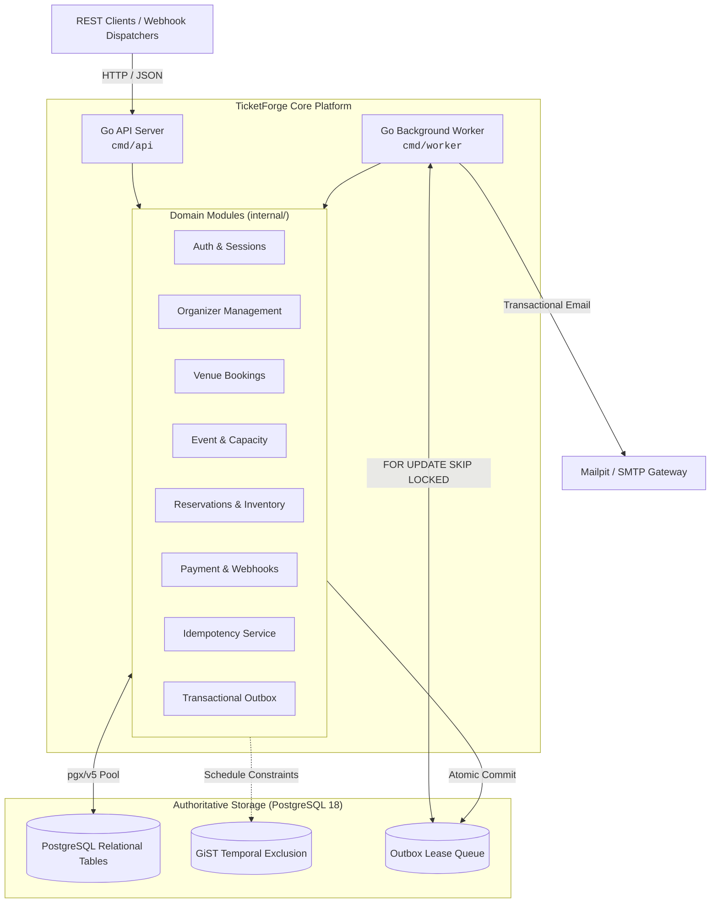
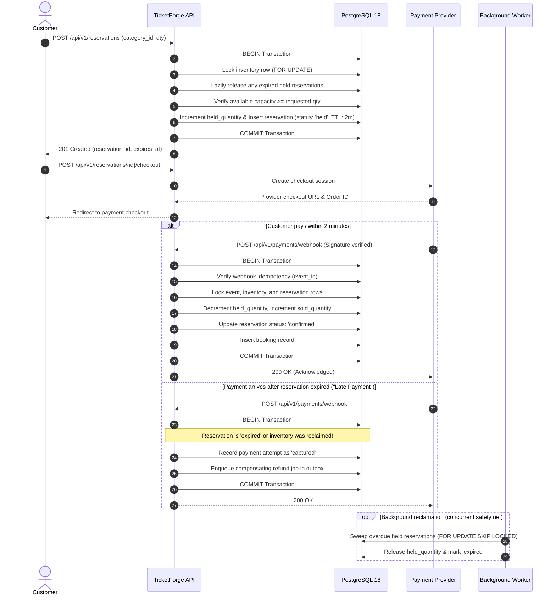
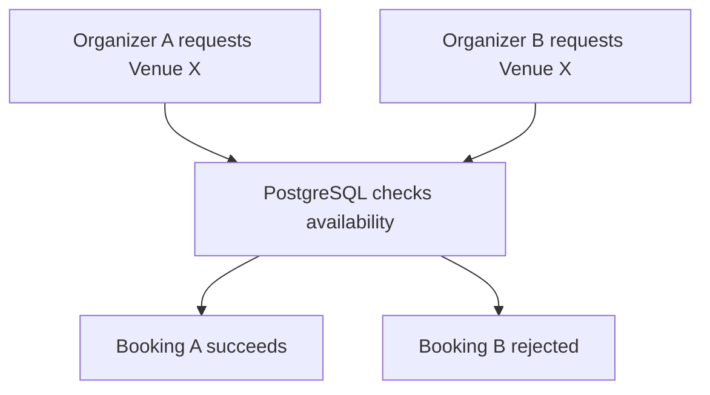
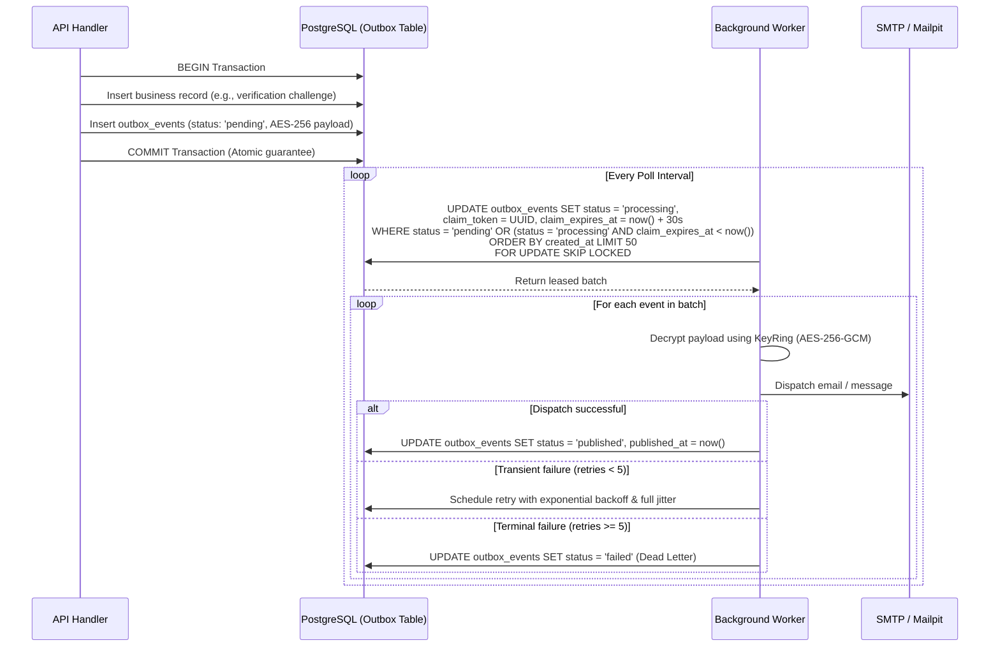
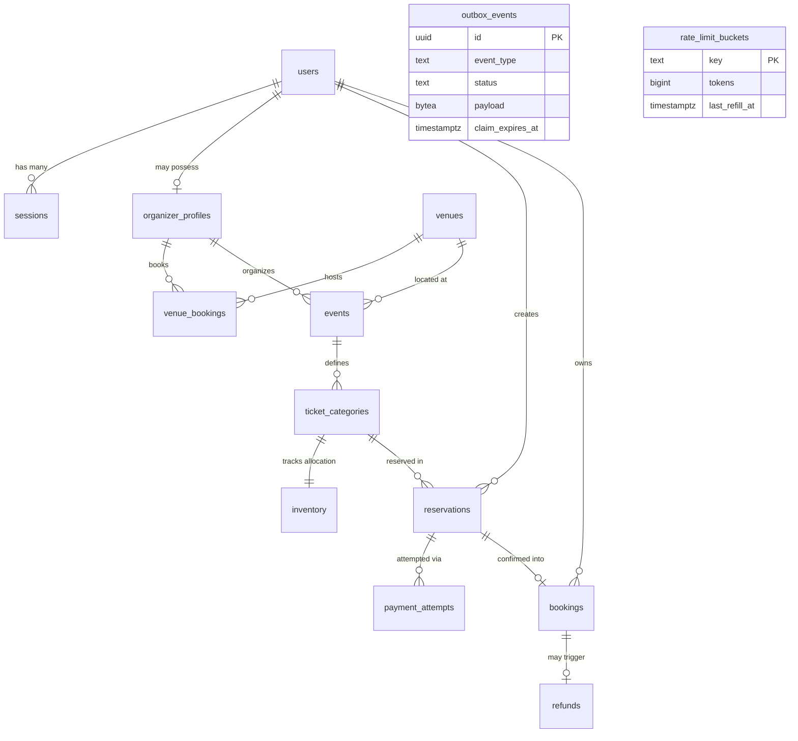

# 🎟️ TicketForge

[](https://go.dev/)
[](https://www.postgresql.org/)
[]()
[]()
[](LICENSE)

> **A high-concurrency ticket booking engine built with idiomatic Go and PostgreSQL 18.**
> Engineered from first principles to guarantee transactional correctness, eliminate overselling and double bookings, and handle real-world asynchronous failure modes.

---

## 📌 Executive Summary

TicketForge solves the classic distributed systems challenge in high-demand event ticketing: **allocating strictly bounded inventory across millions of concurrent requests without overselling, deadlocks, or financial discrepancies.**

Rather than leaning on premature microservices or caching layers that compromise ACID invariants, TicketForge adopts a **SQL-first, modular monolith architecture** backed by **PostgreSQL 18**. Deep database engine capabilities—such as GiST exclusion constraints on temporal ranges, atomic `FOR UPDATE SKIP LOCKED` row locking, and transactional outbox leasing—are leveraged to make race conditions physically impossible at the storage layer while keeping operational overhead lean.

### 🌟 Core Engineering Highlights

- **Zero-Overselling Two-Phase Inventory**: 2-minute temporary reservations (`held`) backed by deterministic row locking, automated background reclamation, and lazy expiration on demand.
- **Physical Venue Conflict Prevention**: Zero overlapping bookings at the same physical venue guaranteed at the database engine level using PostgreSQL `tstzrange` intervals and `btree_gist` exclusion constraints.
- **Transactional Outbox with Batch Leasing**: Guaranteed at-least-once asynchronous event delivery with concurrent worker batch leasing (`FOR UPDATE SKIP LOCKED`), exponential backoff with full jitter, and dead-letter handling.
- **Late Payment Compensation**: Resilient payment webhook processing that detects expired holds, captures the late transaction, and atomically enqueues a compensating refund job.
- **Hardened Security & Sessions**: Argon2id password hashing with constant-time dummy verification against timing enumeration, sliding stateful sessions in PostgreSQL, and AES-256-GCM envelope encryption for sensitive outbox payloads with a versioned KeyRing.
- **SQL-First Tooling**: Type-safe compiled queries via `sqlc`, versioned migrations via `goose`, and native `pgx/v5` pooling—100% free of ORM bloat or runtime reflection.

---

## 🏛️ High-Level System Architecture

TicketForge runs as two distinct process entry points sharing cohesive domain modules:

1. **API Process (`cmd/api`)**: High-throughput REST API serving customer discovery, reservations, organizer controls, and payment webhooks.
2. **Worker Process (`cmd/worker`)**: Resilient background daemon executing the transactional outbox publisher and asynchronous task dispatch.



---

## 🔄 Critical Workflows & System Diagrams

### 1. Two-Phase Reservation & Booking Pipeline

To prevent cart abandonment from permanently exhausting inventory, TicketForge implements a two-phase reservation pipeline. Inventory is held for exactly 2 minutes; upon payment confirmation via webhook, the reservation atomically converts to a confirmed booking.



---

### 2. Physical Venue Overlap Prevention (Database Engine Level)

In multi-organizer platforms, scheduling two overlapping events at the same physical venue is a critical failure. TicketForge delegates range overlap enforcement entirely to PostgreSQL's `btree_gist` index, preventing race conditions even when concurrent requests hit different API server instances.



---

### 3. Transactional Outbox Pattern & Worker Batch-Leasing

Dual-writes to a database and an external message broker/SMTP server risk silent data loss during network partitions or process crashes. TicketForge commits domain changes and outbox events in a **single ACID transaction**, followed by an asynchronous worker leasing loop.



---

## 🧠 Key Architectural Decisions & Engineering Trade-offs

The architecture of TicketForge is documented through **22 formal Architecture Decision Records (ADRs)**. Below are key engineering decisions and justifications:

| Decision | Choice Made | Alternatives Rejected | Rationale |
| :--- | :--- | :--- | :--- |
| **Monolith vs Microservices** ([ADR-001](docs/adr/001-modular-monolith.md)) | **Modular Monolith** | Microservices, Eventual Consistency | Preserves atomic cross-table transactions across inventory, reservations, and outbox tables. Avoids distributed transactions (2PC/Sagas) while maintaining clean module isolation in Go packages. |
| **Data Authority** ([ADR-002](docs/adr/002-postgresql-source-of-truth.md), [ADR-014](docs/adr/014-sql-first-database-tooling.md)) | **PostgreSQL 18 as Single Source of Truth** | Redis-first, MongoDB, ORMs (GORM) | PostgreSQL 18 provides strict serializability, UUIDv7 native keys, temporal range types, and exclusion constraints. Tooling uses `sqlc` for zero-overhead, compile-time verified Go structs. |
| **Venue Scheduling** ([ADR-015](docs/adr/015-event-lifecycle-and-scheduling.md), [ADR-021](docs/adr/021-venue-bookings.md)) | **GiST Exclusion Constraints (`&&`)** | Application-level `SELECT` checks, Redis locks | Application-level range checks suffer from Time-of-Check to Time-of-Use (TOCTOU) races. Database-level `EXCLUDE USING gist` ensures mathematical overlap prevention across distributed API replicas. |
| **Authentication & Sessions** ([ADR-012](docs/adr/012-email-password-authentication-and-sessions.md)) | **Opaque Stateful Sessions in PostgreSQL** | Stateless JWTs | Stateless JWTs cannot be reliably revoked before expiration without maintaining distributed blocklists. Opaque SHA-256 hashed session tokens in PostgreSQL allow instant revocation on logout and sliding idle expiration. |
| **Credential Security** ([ADR-012](docs/adr/012-email-password-authentication-and-sessions.md), [ADR-020](docs/adr/020-authentication-abuse-protection.md)) | **Argon2id + Constant-Time Dummy Verification** | bcrypt, scrypt, standard comparisons | Argon2id provides memory-hard protection against ASIC/GPU brute-forcing. When non-existent emails attempt login, a dummy password hash is calculated to mitigate timing enumeration attacks. |
| **Event Reliability** ([ADR-013](docs/adr/013-email-verification-and-delivery.md)) | **Transactional Outbox with Batch Leasing** | Dual-writing to message brokers directly | Dual writes inherently fail when one network call fails. Writing outbox records in the same transaction guarantees zero message loss. Leased batching via `FOR UPDATE SKIP LOCKED` allows scalable horizontal worker pooling. |
| **Late Payments** ([ADR-005](docs/adr/005-simulated-payment.md), [ADR-008](docs/adr/008-reservation-expiration.md)) | **Capturing Late Payment & Auto-Refunding** | Rejecting payment at gateway, Silent drops | Webhook calls can be delayed by network latency. If a user was charged but the 2-minute hold expired, rejecting the webhook loses financial traceability. The system captures the charge and enqueues a refund. |
| **Rate Limiting** ([ADR-019](docs/adr/019-rate-limiting-infrastructure.md)) | **PostgreSQL Token Bucket with HMAC Keys** | In-memory limiter, Redis | Token buckets implemented directly in PostgreSQL using atomic SQL updates keep the operational footprint minimal while maintaining global rate limiting across all API nodes. HMAC protects user IP privacy. |
| **API Idempotency** ([ADR-022](docs/adr/022-idempotency.md)) | **Idempotency Keys with Request Hashing** | Blind retries | Client mutations accept an `Idempotency-Key` header. Requests store a SHA-256 payload hash and response status in PostgreSQL, preventing duplicate charges or bookings during network retries. |

*Explore all 22 ADR documents in the [`docs/adr/`](docs/adr/) directory.*

---

## 🗄️ Database Architecture & Schema Design

TicketForge leverages advanced PostgreSQL 18 relational modeling primitives:

- **`uuidv7()` Primary Keys**: Sequential, time-ordered 128-bit identifiers optimizing B-tree index locality and insertion performance compared to random UUIDv4.
- **Half-Open Range Types (`tstzrange`)**: Native temporal intervals `[starts_at, ends_at)` modeling exact event durations and venue booking windows.
- **Check Constraints (`CHECK`)**: Guaranteed financial invariants (e.g., `total_price_minor = quantity * unit_price_minor`) and non-negative inventory quantities enforced directly in table definitions.
- **Integer Minor Units**: All monetary amounts are modeled as `bigint` paisa (INR) to eliminate IEEE 754 floating-point rounding errors.

### Entity Relationship Model



---

## 📂 Codebase Layout

The project follows standard, idiomatic Go package design. Business logic is strictly decoupled from HTTP transport and infrastructure adapters.

```text
ticket-forge/
├── cmd/
│   ├── api/                    # API server entry point & HTTP router assembly
│   └── worker/                 # Background worker entry point (outbox processor)
├── db/
│   ├── migrations/             # Versioned SQL migrations (Goose)
│   ├── queries/                # Pure SQL query definitions (sqlc inputs)
│   └── seeds/                  # Baseline seed data for venues and development
├── docs/                       # Comprehensive architectural documentation
│   ├── adr/                    # 22 Architecture Decision Records
│   ├── hld.md                  # High-Level Design specification
│   ├── sequence-diagrams.md    # End-to-end workflow sequence diagrams
│   ├── state-machines.md       # Entity lifecycles & transition tables
│   ├── er-diagram.md           # Entity relationship model documentation
│   └── failure-analysis.md     # Production failure modes & recovery plans
├── internal/
│   ├── auth/                   # Authentication, Argon2id, session middleware, rate limits
│   ├── booking/                # Reservation lifecycle, inventory holds, confirmation
│   ├── event/                  # Event management, scheduling boundaries, booking toggles
│   ├── venuebooking/           # Venue booking with GiST exclusion constraints
│   ├── organizer/              # Self-service organizer activation & profiles
│   ├── payment/                # Payment service, webhook verification, simulator
│   │   └── simulator/          # Embedded checkout UI & HMAC signature generator
│   ├── outbox/                 # Outbox repository, worker loop, batch leasing
│   ├── ratelimit/              # PostgreSQL token bucket & HMAC key deriver
│   ├── security/               # AES-256-GCM encryption, KeyRing, tokens, passwords
│   ├── idempotency/            # Request hashing & idempotent replay repository
│   ├── email/                  # SMTP sender (Mailpit) & HTML email templates
│   ├── database/               # pgx connection pool & generated sqlc models
│   └── config/                 # Environment-based configuration loader
├── compose.yaml                # PostgreSQL 18 & Mailpit local infrastructure
├── Makefile                    # Build, test, and vet recipes
├── sqlc.yaml                   # sqlc code generation configuration
└── go.mod                      # Go module dependencies
```

---

## 🚦 Implementation Status

The project is actively under development, following an iterative, test-driven approach where documentation and architectural design precede implementation:

| Module / Feature | Status | Test Coverage | Key Details |
| :--- | :---: | :---: | :--- |
| **Authentication & Registration** | ✅ Implemented | Unit + Integration | Email-first challenge flow, Argon2id hashing, timing attack protection. |
| **Session Management** | ✅ Implemented | Unit + Integration | Opaque tokens, sliding 30-min idle timeout, 7-day absolute lifetime. |
| **Rate Limiting & Abuse Defense** | ✅ Implemented | Unit + Integration | PostgreSQL token bucket, HMAC-SHA256 client masking, brute-force defense. |
| **Transactional Outbox Worker** | ✅ Implemented | Unit + Integration | Leased batching (`SKIP LOCKED`), AES-256 payload encryption, backoff retries. |
| **Email Delivery Adapter** | ✅ Implemented | Unit + Mock SMTP | SMTP dispatch to Mailpit, HTML templates for verification & password reset. |
| **Venue Booking & Scheduling** | ✅ Implemented | Unit + Integration | `btree_gist` temporal exclusion constraint, scheduling validation. |
| **Organizer Profiles** | ✅ Implemented | Unit Tests | Self-service activation, resource ownership verification. |
| **Event Lifecycle & Availability** | ✅ Implemented | Unit + Integration | Event creation, schedule boundaries, pause/resume booking controls. |
| **Two-Phase Ticket Reservations** | ✅ Implemented | Unit + Integration | 2-minute held TTL, concurrency-safe inventory holds, lazy expiration. |
| **Simulated Payment Provider** | ✅ Implemented | Unit + Integration | Hosted checkout simulation, webhook HMAC-SHA256 signatures, late payment refunds. |
| **Idempotency Layer** | ✅ Implemented | Unit + Integration | Atomic request payload hash tracking and duplicate request replay. |
| **Prometheus & OpenTelemetry** | ⏳ Planned | — | Metrics, tracing, and structured dashboards. |
| **Redis Caching Tier** | ⏳ Planned | — | Read-through caching for high-traffic event catalog discovery. |

---

## 🛠️ Getting Started

### Prerequisites

- **Go**: 1.25+
- **Docker & Docker Compose**: For PostgreSQL 18 and Mailpit containers
- **Make**: For running build and test targets

### 1. Clone & Set Up Environment

```bash
git clone https://github.com/Punith1117/ticket-forge.git
cd ticket-forge
```

Create a `.env` file based on configuration defaults:

```bash
cp .env.example .env # or configure database credentials
```

### 2. Start Local Infrastructure

Start PostgreSQL 18 and Mailpit:

```bash
docker compose up -d
```

- **PostgreSQL 18**: Listening on `localhost:5433` (configurable via `POSTGRES_PORT`)
- **Mailpit Web UI**: Open `http://localhost:8025` to inspect outbound emails

### 3. Run Migrations & Build

Apply the Goose database migrations:

```bash
# Using goose or make targets
make build
```

### 4. Run the Test Suite

TicketForge maintains high test coverage with unit tests, database integration tests, and race condition verification:

```bash
# Run unit tests (no database required)
make test-short

# Run all unit and integration tests with the Go race detector
make test

# Run Go static analysis
make vet
```

### 5. Launch the Services

In separate terminal sessions:

```bash
# Start the HTTP API Server (default :8080)
go run cmd/api/main.go

# Start the Asynchronous Outbox Worker
go run cmd/worker/main.go
```

Inspect health at:

```bash
curl http://localhost:8080/healthz
# Output: {"status":"ok"}
```

---

## 👨‍💻 Engineering Philosophy & Practices

1. **Transactional Correctness Over Premature Speed**: Never compromise data integrity for hypothetical scale. A booking system that sells the same seat twice is broken, regardless of its queries-per-second metric.
2. **PostgreSQL as an Engine, Not a Dumb Store**: Take full advantage of PostgreSQL's mature relational features—exclusion constraints, check constraints, row-level locks, and generated columns—instead of reinventing synchronization in the application layer.
3. **No Magic**: No ORMs, no hidden reflection, no unpredictable query generation. SQL queries are typed, reviewed, and compiled with `sqlc`.
4. **Resilient Failure Modes**: Design for transient network partitions, process crashes, and out-of-order webhooks from day one.

---

## 📄 Documentation Index

- [Requirements & Specifications](docs/requirements.md)
- [High-Level Design (HLD)](docs/hld.md)
- [Domain Model](docs/domain-model.md)
- [Entity-Relationship Diagram](docs/er-diagram.md)
- [System State Machines](docs/state-machines.md)
- [Sequence Diagrams](docs/sequence-diagrams.md)
- [Failure Analysis & Recovery](docs/failure-analysis.md)
- [Architecture Decision Records (ADRs)](docs/adr/)
