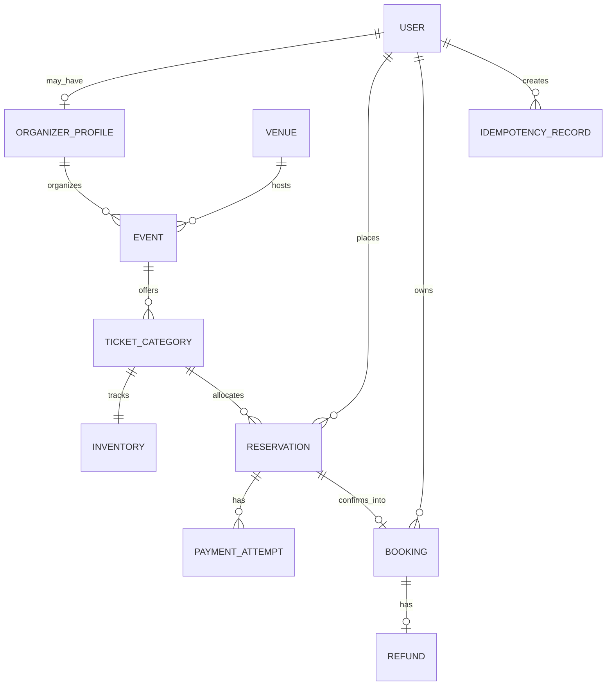

# Domain Model

**Status:** Accepted

## Domain Overview

TicketForge's central domain is allocating limited ticket inventory to customers while managing events at shared physical venues.

Three concepts must remain distinct:

- **Inventory:** Capacity and allocation quantities.
- **Reservation:** Temporary hold on inventory.
- **Booking:** Confirmed ticket allocation.

A reservation is not automatically a booking.

The system also manages venue scheduling. A physical venue can host multiple events, but their scheduled time intervals must not overlap.

The domain distinguishes between three independent concerns:

- **Event lifecycle:** Whether an event is active or cancelled.
- **Booking availability:** Whether new reservations can currently be accepted.
- **Inventory availability:** Whether sufficient ticket inventory remains.

These concepts must not be represented by a single status field.

## Core Domain Concepts

### User

Represents an authenticated person.

Every user can act as a customer. A user may additionally have an OrganizerProfile.

A user does not need separate accounts to act as a customer and an organizer.

### OrganizerProfile

Grants organizer capabilities to a User.

Organizer activation is immediate in the initial version. Identity verification and organizer approval workflows are outside the MVP scope.

An organizer can create and manage their own events.

Each event belongs to exactly one organizer.

### Venue

Represents a physical location where events are hosted.

Venues are managed exclusively by the platform and maintained in a shared venue catalog.

Organizers cannot create, edit, activate, deactivate, or delete venue records through the initial application.

A venue contains:

- Name.
- Street address (`street_address`).
- City.
- State.
- Postal code.
- Country code (`country_code`).
- IANA timezone.
- Physical capacity.
- Activation state (`is_active`).

Address information is stored using separate structured fields rather than a single unstructured address string.

The country code uses the ISO 3166-1 alpha-2 format.

The venue timezone is stored as an IANA timezone identifier, such as `Asia/Kolkata`.

A venue can host multiple events, provided their scheduled time intervals do not overlap.

A venue has two operational states:

- **Active:** Available for new event creation and event rescheduling.
- **Inactive:** Cannot be selected for new events or rescheduling.

Inactivating a venue does not cancel existing events. Existing active events continue to occupy their scheduled intervals.

Referenced venues are not physically deleted.

### Event

Represents a scheduled occurrence at a physical venue.

Each event belongs to exactly one organizer and references exactly one platform-managed venue.

An event contains:

- Title and description.
- Organizer reference.
- Venue reference.
- Start and end timestamps.
- Sales start and end timestamps.
- Lifecycle status.
- Booking availability status.

#### Event lifecycle

An event has two persisted lifecycle states:

- `active`
- `cancelled`

An event is created directly as `active`. There is no Draft or Published lifecycle state.

Cancellation is terminal:

`active -> cancelled`

A cancelled event cannot be reactivated. An organizer who wants to run the event again must create a new event.

Event completion is derived rather than persisted. An active event is considered completed when:

`current_time >= ends_at`

Completion does not require a separate lifecycle status or background status transition.

An active event may exist before ticket categories or inventory have been configured. Being active does not automatically mean that the event is bookable.

#### Event scheduling

An event must satisfy the following scheduling rules:

- Minimum duration: 15 minutes.
- Maximum duration: 7 days.
- Start time must be at least 15 minutes in the future when created.
- Start time must be no more than one calendar year in the future when created.
- The same scheduling boundaries apply when rescheduling.

The one-year horizon uses calendar arithmetic rather than a fixed 365-day duration.

Boundary comparisons are inclusive.

Event start and end timestamps use PostgreSQL `timestamptz`.

An event occupies the half-open interval:

`[starts_at, ends_at)`

Two active events at the same venue must not have overlapping intervals.

No additional setup or cleanup buffer is reserved between events.

The database enforces the venue scheduling invariant through a PostgreSQL GiST exclusion constraint backed by `btree_gist`.

#### Event rescheduling

An organizer may reschedule an event only if:

1. The event is still active.
2. The event has never had a confirmed booking.
3. The event has no valid, unexpired Held reservations.
4. The new schedule satisfies all event scheduling constraints.
5. The destination venue is active.
6. The new time interval does not conflict with another active event at the destination venue.

Rescheduling is permanently prohibited after the first confirmed booking has existed, even if that booking is subsequently refunded.

The system must preserve the historical fact that a confirmed booking has existed.

Rescheduling must be transactional and coordinated with reservation creation and payment confirmation.

#### Event cancellation

An organizer may cancel their own event, including after confirmed bookings exist.

Cancellation:

- Prevents new reservations.
- Prevents further payment confirmations.
- Invalidates outstanding Held reservations.
- Releases their reserved inventory exactly once.
- Initiates full refunds for confirmed bookings.

Refund processing is asynchronous and separate from the event cancellation transaction.

A cancelled event cannot be booked regardless of its booking availability state.

### TicketCategory

Represents a general-admission ticket type for an event.

Examples:

- Standard.
- VIP.
- Early Bird.

Each category has:

- Name.
- Current price.
- Currency.
- Allocated capacity.
- Active status.

An event may have zero or more ticket categories. It can exist without bookable inventory.

A category's allocated capacity represents the maximum inventory assigned to that category, not the number of tickets already sold.

The sum of allocated capacities across all categories must not exceed the venue's physical capacity.

An organizer may change a category's current price, including after ticket sales begin.

A price change applies only to reservations created after the change. Existing reservations and bookings retain their original price information.

A category's capacity cannot be reduced below its committed inventory, which includes confirmed bookings and valid, unexpired Held reservations.

Automatic price tiers and scheduled early-bird transitions are deferred.

### Inventory

Tracks the allocation quantities of a ticket category.

The initial model maintains:

- Reserved quantity.
- Sold quantity.

The category's allocated capacity is the authoritative capacity limit.

Available quantity is derived:

`available = capacity - reserved_quantity - sold_quantity`

Where `capacity` is the corresponding TicketCategory's allocated capacity.

Inventory changes must be transactional.

Database constraints and concurrency control must prevent overselling.

The total allocated capacity across all ticket categories for an active event must not exceed the physical capacity of its venue:

`SUM(ticket_category.capacity) <= venue.capacity`

The venue capacity is the only global capacity ceiling. No additional platform-wide ticket inventory limit is introduced.

Increasing venue capacity does not automatically increase existing event inventory.

Reducing venue capacity must be rejected if the proposed capacity is below the total allocated ticket capacity of any active event at that venue.

Capacity changes must coordinate with reservations, payment confirmation, category modifications, and event venue assignments.

### Reservation

Represents a temporary hold on a quantity of tickets.

It belongs to exactly one customer and one ticket category.

It has:

- Quantity.
- Status.
- Unit price snapshot.
- Currency.
- Total price snapshot.
- Creation timestamp.
- Expiration timestamp.

The initial reservation duration is two minutes.

The expiration time is determined by server-side policy. Payment retries do not extend the expiration time.

A failed simulated payment leaves the reservation Held, provided it has not expired or otherwise become ineligible.

A customer may cancel their own Held reservation.

When a Held reservation expires or is cancelled:

- It transitions out of Held state.
- Its reserved inventory is released exactly once.
- It cannot subsequently be confirmed.

A valid Held reservation remains eligible for payment confirmation when an event's booking availability is paused.

However, a Held reservation cannot be confirmed if its event has been cancelled.

### Booking

Represents a confirmed ticket allocation.

It originates from a successful reservation confirmation.

It stores the final quantity and price information required for historical records.

Confirmed bookings cannot be individually cancelled by customers in the initial version.

When an organizer cancels an event, a full refund is initiated for each confirmed booking associated with that event.

A refund does not restore sold inventory or make the tickets available for sale again.

The booking remains a historical record of the confirmed allocation. Refund status is tracked separately.

### PaymentAttempt

Represents an attempt to complete the simulated payment process.

It records:

- Reservation.
- Amount and currency.
- Outcome.
- Relevant timestamps.
- A reference identifying the simulated attempt.

A reservation may have multiple payment attempts.

A failed attempt does not automatically expire or cancel the reservation. The customer may retry while the reservation remains eligible.

Payment attempts do not represent real money movement.

Payment confirmation must validate reservation eligibility and event lifecycle state.

A payment callback must not confirm a reservation belonging to a cancelled event or an expired or otherwise ineligible reservation.

### Refund

Represents a refund initiated because an event was cancelled.

It is associated with a confirmed booking.

It records:

- Booking.
- Amount and currency.
- Refund status.
- Creation and completion timestamps.
- Relevant failure information.

The initial implementation uses simulated full refunds.

Refund operations must be persisted independently of booking records.

Refund processing must:

- Be idempotent.
- Avoid duplicate successful refunds.
- Record failure details.
- Remain retryable after failure.
- Support asynchronous processing.

A failed refund must not reactivate the cancelled event or restore sold inventory.

Event cancellation must not depend on successful refund completion.

### IdempotencyRecord

Stores the result of a client operation.

It prevents retries from accidentally creating duplicate reservations or bookings.

It should be scoped by authenticated user, operation, and idempotency key.

A request fingerprint prevents reuse of the same key with a different payload.

### OutboxEvent

A durable event record written in the same database transaction as the business change that requires publication.

An asynchronous publisher later forwards it to the message broker.

The outbox is a database table, not a separate infrastructure service.

It supports reliable asynchronous processing, including refund workflows and other operations that must survive process failures.

## Domain Relationships

Notes:

- An event may exist without ticket categories.
- A reservation can produce at most one booking.
- A booking may have no refund or one full-refund record in the initial release.
- Retrying a refund operates on the existing refund record rather than creating duplicate successful refunds.
- Outbox events are associated with business transactions and are not represented as a direct relationship to a single domain entity in this logical diagram.

## Domain Rules

### Identity and Organizer Rules

1. Every registered user can act as a customer.
2. A user may have zero or one organizer profile.
3. Organizer activation is immediate in the initial version.
4. An organizer can manage only their own events.
5. Each event belongs to exactly one organizer.

### Venue Rules

1. Venues are platform-managed catalog entries.
2. Organizers can browse and select existing active venues.
3. Organizers cannot create, modify, activate, deactivate, or delete venues.
4. Venue addresses are stored using separate structured fields.
5. Each venue has an IANA timezone and physical capacity.
6. Only active venues can be selected for new events or rescheduling.
7. Inactivating a venue does not cancel existing events.
8. Existing active events at an inactive venue continue to occupy their scheduled intervals.
9. Referenced venues cannot be physically deleted.
10. Venue capacity increases do not automatically increase event inventory.
11. Venue capacity reductions must not make any active event's allocated inventory exceed the proposed capacity.

### Event Lifecycle and Scheduling Rules

1. Events have only two persisted lifecycle states: `active` and `cancelled`.
2. Events are created directly as active. There is no Draft or Published lifecycle state.
3. Event completion is derived when the current time reaches or exceeds `ends_at`.
4. A cancelled event cannot be reactivated.
5. Every event references exactly one existing venue and belongs to exactly one organizer.
6. Event duration must be at least 15 minutes and no more than 7 days.
7. Event creation requires a start time at least 15 minutes in the future.
8. Event creation must not schedule the start time more than one calendar year in the future.
9. The same scheduling boundaries apply to rescheduling.
10. The one-year scheduling horizon uses calendar arithmetic, not a fixed 365-day duration.
11. Time-dependent scheduling rules are validated by the application at the time of the write.
12. A venue cannot host overlapping active events.
13. Event scheduling intervals use half-open semantics: `[starts_at, ends_at)`.
14. No separate setup or cleanup buffer is reserved between events.
15. Only active events participate in venue scheduling conflict checks.
16. Rescheduling is prohibited after the event has ever had a confirmed booking.
17. Rescheduling is prohibited while valid, unexpired Held reservations exist.
18. Rescheduling requires an active destination venue and must satisfy all scheduling constraints.
19. Event creation and rescheduling must rely on database-level conflict enforcement, not application checks alone.

### Booking Availability Rules

1. Booking availability is independent of event lifecycle.
2. An event has a persisted booking availability state: `open` or `paused`.
3. The default booking availability state is `open`.
4. Pausing bookings prevents new reservations.
5. Pausing bookings does not invalidate existing Held reservations.
6. Existing eligible Held reservations may still complete payment while bookings are paused.
7. Pausing bookings does not extend reservation expiration.
8. Effective availability is derived from event lifecycle, booking state, sales window, and remaining inventory.
9. An active event is not necessarily bookable.
10. A cancelled event cannot accept reservations or payment confirmations, regardless of booking availability state.

### Ticket and Pricing Rules

1. An event may have zero or more ticket categories.
2. Ticket category capacity cannot be negative.
3. Reservation quantity must be positive.
4. Total allocated capacity across an event's ticket categories must not exceed venue capacity.
5. A ticket category's capacity cannot be reduced below its committed inventory.
6. Committed inventory includes confirmed bookings and valid, unexpired Held reservations.
7. Available inventory is derived from allocated capacity, reserved quantity, and sold quantity.
8. Changing a ticket category's current price affects only subsequently created reservations.
9. Existing reservation and booking prices must not change when the current category price changes.

### Reservation and Booking Rules

1. A reservation belongs to exactly one customer.
2. A reservation has a server-determined expiration time.
3. The initial reservation duration is two minutes.
4. Payment retries do not extend reservation expiry.
5. A failed payment attempt leaves an otherwise eligible reservation Held.
6. A customer may cancel their own Held reservation.
7. A cancelled or expired reservation cannot subsequently be confirmed.
8. A reservation can produce at most one confirmed booking.
9. A reservation cannot be confirmed after it expires.
10. A reservation belonging to a cancelled event cannot be confirmed.
11. Pausing event bookings does not invalidate an otherwise eligible Held reservation.
12. Confirmed bookings cannot be individually cancelled by customers in the initial version.
13. Event cancellation initiates full refunds for confirmed bookings.
14. Refunds do not restore sold inventory.

### Inventory Rules

1. Inventory modifications must enforce the inventory invariants transactionally.
2. Inventory must be released exactly once when a Held reservation expires or is cancelled.
3. Confirmation moves quantity from reserved to sold without changing total allocated quantity.
4. Event cancellation must not result in duplicate inventory releases or duplicate refunds.
5. Total allocated category capacity must not exceed venue capacity.
6. Capacity reductions must preserve all existing committed inventory.
7. Capacity checks spanning multiple rows require transactional coordination and appropriate locking.
8. The database is the authoritative source of inventory state.

### Payment and Refund Rules

1. Failed payment attempts must be retained.
2. A reservation may have multiple payment attempts.
3. A successful payment can create at most one booking.
4. Payment confirmation must validate reservation and event eligibility.
5. Event cancellation initiates a full refund for each confirmed booking.
6. Refund failures must be recorded and safely retryable.
7. Refund processing is separate from booking and inventory accounting.
8. Event cancellation must not depend on successful refund completion.
9. Delayed payment callbacks must not confirm bookings after event cancellation.

### Concurrency and Transaction Rules

1. Reservation creation, payment confirmation, expiration, and cancellation must coordinate through database transactions and appropriate locking.
2. Event cancellation and payment confirmation must not produce an invalid confirmed booking.
3. Rescheduling and payment confirmation must not race in a way that bypasses rescheduling restrictions.
4. Rescheduling and reservation creation must coordinate so that no valid Held reservation is introduced concurrently in a way that violates the rescheduling policy.
5. Venue scheduling conflicts must be prevented by a database exclusion constraint.
6. Capacity changes and inventory allocation must use transactional coordination.
7. Background processing must be idempotent and safe to retry.
8. PostgreSQL is the source of truth for all persisted business state.

## Suggested Logical Modules

These are conceptual boundaries, not a requirement to create one package for every entity.

- **Identity and Access:** Users, authentication, organizer profiles.
- **Catalog:** Platform-managed venues, events, ticket categories.
- **Inventory:** Capacity, allocation, reservation holds, release.
- **Booking:** Reservations, confirmations, booking records.
- **Payment Simulation:** Simulated payment attempts.
- **Refund Processing:** Simulated refunds and refund outcomes.
- **Async Processing:** Outbox, publisher, consumers, expiration and refund workers.

## Persistence Conventions

These are database implementation conventions rather than additional domain concepts.

1. Database-generated entity identifiers use PostgreSQL 18's `uuidv7()` as the default UUID generator.
2. Event timestamps use PostgreSQL `timestamptz`.
3. Persisted lifecycle and availability values use consistent lowercase representations.
4. Database constraints enforce invariants that can be expressed safely at the database level.
5. Time-dependent rules are validated by the application at write time rather than using time-dependent `CHECK` constraints.
6. Cross-row capacity invariants are enforced through transactions and appropriate locking.

## Deferred Decisions

The following decisions are intentionally not finalized:

1. Are ticket quantities limited per customer?
2. How long should idempotency records be retained?
3. What is the retention policy for expired reservations?
4. What is the retention policy for published outbox events?
5. Should organizer verification be introduced in a future version?
6. Should automatic early-bird and scheduled price tiers be supported?
7. What operational workflow should be used to inspect and retry failed refunds?
8. Should a future venue onboarding workflow allow organizers to request new venues?
9. Should the system validate venue timezone values against a canonical IANA timezone list?
