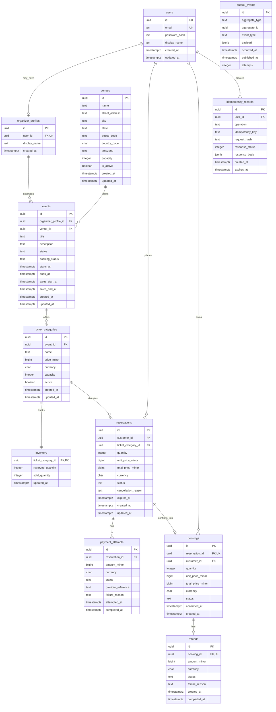

# Initial Entity-Relationship Model

**Status:** Accepted  
**Scope:** General-admission ticketing

## ER Diagram

## Modeling Notes

### Users and Organizer Profiles

A user can have zero or one organizer profile.

Every registered user can act as a customer.

We do not need separate customer and organizer account tables.

Organizer activation is immediate in the initial version. A user can act as an organizer as soon as their organizer profile is created.

A user may act as both a customer and an organizer using the same account.

### Venues

Venues are platform-managed catalog entries.

They are not owned by organizers.

Organizers select an existing venue when creating an event. The event references the venue through `venue_id`.

The initial catalog can be populated using seed data and maintained through controlled operational scripts.

A venue stores:

- Its name.
- Structured address fields: `street_address`, `city`, `state`, `postal_code`, and `country_code`.
- Its IANA timezone, such as `Asia/Kolkata`.
- Its physical capacity.
- Its active/inactive state through `is_active`.

The `country_code` uses ISO 3166-1 alpha-2.

Only active venues can be selected when creating or rescheduling an event.

Deactivating a venue does not automatically cancel its existing events. Those events continue to occupy the venue's schedule.

Referenced venues cannot be physically deleted. The database must prevent deletion while events reference the venue.

A venue stores its physical capacity. This represents the maximum number of people the physical location can accommodate.

For every event:

- The sum of its ticket-category capacities must not exceed the venue's physical capacity.
- Each ticket category has its own capacity.
- The combined capacity of all ticket categories represents the event's maximum ticket allocation.

For example, if a venue has a physical capacity of 1,000, an event may have:

| Ticket category | Capacity |
| --- | ---: |
| General | 500 |
| Premium | 300 |
| VIP | 100 |
| **Total** | **900** |

The configuration is valid because 900 does not exceed the venue's physical capacity of 1,000.

This is an aggregate invariant across multiple ticket-category rows. A simple SQL `CHECK` constraint cannot enforce it. The implementation must enforce it transactionally, with an appropriate database-level concurrency strategy.

A venue capacity reduction must be rejected if it would make the allocated capacity of any active event exceed the proposed venue capacity.

Increasing venue capacity does not automatically increase any event's ticket-category capacities.

### Events and Scheduling

Each event references exactly one organizer profile and one venue.

An event must reference an existing platform-managed venue.

The persisted event lifecycle has two states:

- `active`
- `cancelled`

Cancellation is terminal. A cancelled event cannot be reactivated. If an organizer wants to run the event again, they must create a new event.

Event completion is derived from time: an active event is considered completed when the current time reaches or passes `ends_at`. Completion is not a persisted event status.

An event has a separate booking availability state:

- `open`
- `paused`

This state is independent of the event lifecycle. Pausing booking availability prevents new reservations but does not itself cancel the event.

Effective booking availability is derived from the event lifecycle, booking availability state, sales window, and remaining inventory.

An event may exist without any ticket categories. An active event is not necessarily bookable.

The event's scheduled interval is:

`[starts_at, ends_at)`

The end is exclusive. Therefore, an event ending at 15:00 and another starting at 15:00 do not overlap.

Only active events participate in venue conflict checks.

Two active events at the same venue must not have overlapping scheduled intervals.

The scheduling rules are:

- Minimum event duration: 15 minutes.
- Maximum event duration: 7 days.
- Event start must be at least 15 minutes in the future.
- Event start must be no more than one calendar year in the future.
- The same scheduling boundaries apply when rescheduling.

The one-calendar-year boundary uses calendar arithmetic rather than a fixed number of days.

Time-dependent scheduling rules are validated by the application at write time.

The application must not rely solely on a separate availability query followed by an insert. Concurrent event creation must be protected by database-level concurrency control.

PostgreSQL range types and exclusion constraints are the intended implementation approach. The exact schema and constraint will be finalized during SQL design. The constraint should use half-open intervals and apply only to active events.

A cancelled event no longer occupies its venue schedule.

#### Event rescheduling

An event may be rescheduled only if it has never had any reservation or booking associated with it.

This means:

- No Held reservations.
- No expired reservations.
- No cancelled reservations.
- No confirmed bookings.
- No refunded bookings.

Reservation records must be retained as historical records rather than physically deleted when they expire or are cancelled. This allows the system to determine whether an event has ever had a reservation without introducing a separate historical marker.

Rescheduling must be performed transactionally and coordinated with reservation creation and payment confirmation so that a reservation cannot be created concurrently while the event is being rescheduled.

The destination venue must be active and the new schedule must satisfy all scheduling constraints and venue-overlap rules.

A cancelled event is never rescheduled. An organizer who wants to run it again must create a new event.

### Ticket Categories

Each ticket category belongs to exactly one event.

An event may have zero or more ticket categories.

A category has a current price, currency, allocated capacity, and active state.

Organizers may change the current price, including after sales begin.

A price change applies only to reservations created after the change.

Existing reservations retain their original price snapshots. Existing bookings retain their historical price information.

The sum of an event's ticket-category capacities must not exceed the physical capacity of its venue.

A ticket-category capacity reduction must not reduce capacity below its committed inventory: reserved quantity plus sold quantity.

Capacity changes must be coordinated transactionally with reservation and booking operations.

### Inventory

Each ticket category has exactly one inventory record.

The available quantity is derived:

`available = capacity - reserved_quantity - sold_quantity`

Capacity is stored on `ticket_categories`. The inventory table tracks reserved and sold quantities; it must not duplicate category capacity.

We should avoid storing redundant availability values unless later measurements justify it.

Database constraints must prevent:

- Negative reserved quantity.
- Negative sold quantity.
- Reserved plus sold quantity exceeding category capacity.

Additionally, the sum of ticket-category capacities for an event must not exceed its venue's physical capacity.

Inventory changes must be atomic with their corresponding reservation or booking state transitions.

Confirmation moves quantity from reserved to sold without changing the total allocated quantity.

Expiration and cancellation release reserved inventory exactly once.

Event cancellation must invalidate existing Held reservations and release their reserved inventory exactly once. This must be coordinated with the reservation expiration worker so that concurrent processing cannot release the same quantity twice.

Refund processing must not modify inventory.

### Reservations

A reservation belongs to exactly one customer and one ticket category.

A reservation stores a snapshot of the ticket price at creation time.

It must not depend on the current ticket-category price when calculating an existing reservation's payment amount.

The initial reservation duration is two minutes.

The expiration timestamp is determined by server-side policy. Payment retries do not extend it.

A failed payment attempt leaves an otherwise eligible reservation Held.

A reservation cannot be confirmed after it expires.

A reservation can produce at most one confirmed booking. A unique constraint on `bookings.reservation_id` enforces this relationship.

When an event is cancelled:

- New reservations for the event are rejected.
- Existing Held reservations are invalidated.
- Existing Held reservations cannot be confirmed.
- Their reserved inventory is released exactly once.
- The invalidation and release must be safe when racing with the expiration worker.

The reservation state transition and inventory release must be protected by transactional state checks.

A `cancellation_reason` can distinguish customer cancellation from event cancellation. The exact reservation state names and transition rules are defined in `state-machines.md`.

Reservation records are retained after expiration or cancellation. They provide an audit trail and preserve the historical evidence needed by rules such as event rescheduling eligibility.

An index should support finding expired reservations efficiently, for example:

`(status, expires_at)`

### Payment Attempts

A reservation may have multiple payment attempts.

Each attempt stores its amount and currency so that the historical payment operation is independent of later category price changes.

Failed attempts are retained rather than overwritten.

A failed payment attempt must not create a confirmed booking.

A successful payment can create at most one booking through the reservation's unique booking relationship.

### Bookings

A booking originates from a reservation.

A unique constraint on `reservation_id` prevents multiple bookings from being created from one reservation.

The booking stores historical price information.

Individual confirmed-booking cancellation is not supported in the initial version.

Event cancellation initiates refunds for confirmed bookings.

A booking remains a historical record of the confirmed allocation even when a refund is processed. Refund status is modeled independently and does not require changing the booking back to an unconfirmed state.

### Refunds

Refunds are associated with confirmed bookings.

The initial implementation simulates refund processing.

Refund records preserve the amount, currency, status, failure reason, and relevant timestamps.

A failed refund must remain visible and safely retryable.

Event cancellation initiates a refund for each confirmed booking associated with the event.

Refund processing is separate from inventory accounting:

- A refund does not transition a Confirmed reservation back to Held or another inventory state.
- A refund does not automatically restore sold inventory.
- A failed refund does not reactivate a cancelled event.
- Retrying a refund must not create a duplicate refund operation.

The initial policy is a full refund for event cancellation.

The initial release supports one refund record per booking. A unique constraint on `refunds.booking_id` prevents duplicate refund records for the same booking.

Refund retries operate on the existing refund record rather than creating another one. The refund operation must also be idempotent at the simulated payment-provider boundary.

Refund processing is asynchronous. Event cancellation must durably record the work required to process refunds without waiting for the external refund operation to finish.

### Idempotency Records

A unique constraint should enforce the agreed idempotency scope:

`(user_id, operation, idempotency_key)`

The request hash prevents the same key from being reused with a different payload.

Retention duration and handling of stored failure responses will be finalized before implementation.

### Outbox Events

Outbox records are persisted in the same transaction as the business change.

An index should support efficient retrieval of unpublished events.

The outbox is important for event cancellation and refund processing. The event cancellation transaction must durably record the work that needs to happen after the transaction commits.

For example, the application may publish events representing:

- Event cancellation.
- Refund requests for confirmed bookings.

Held reservation invalidation and inventory release are performed as part of the event cancellation transaction. They are not deferred to an independent background operation.

The exact event types and payloads will be finalized during the asynchronous processing design.

The table may later need fields such as:

- `next_attempt_at`
- `locked_at`
- `last_error`
- `aggregate_version`

These fields can be added when the publisher and retry design are finalized.

### Money

Store money using integer minor units rather than floating-point numbers.

For example, INR 100.50 is stored as 10050 paise.

The initial version supports INR only.

Store the currency code explicitly with monetary values.

Use a consistent currency representation, such as `INR`, in the application and database. The SQL column can use `char(3)` or an appropriate constrained text type.

### Time

Use PostgreSQL `timestamptz` for actual instants.

Store the venue's IANA timezone separately for event presentation and local scheduling rules.

Reservation expiry should be evaluated using authoritative server/database time.

### Persistence Conventions

- Use PostgreSQL 18's `uuidv7()` as the default UUID generator.
- Use `timestamptz` for persisted instants.
- Use lowercase values for persisted status and state strings.
- Use foreign keys to enforce entity relationships.
- Use restrictive deletion behavior for historical records that must be retained.

## Important Database Invariants

The following rules must be enforced by the database, transactional application logic, or both:

1. Every event references an existing venue.
2. Non-cancelled events at the same venue cannot have overlapping time intervals.
3. Only active venues can be selected for new events or event rescheduling.
4. The sum of ticket-category capacities for an event cannot exceed the venue's physical capacity.
5. Available inventory must never become negative.
6. Reserved quantity plus sold quantity must never exceed category capacity.
7. A reservation cannot be confirmed after expiry.
8. A reservation can produce at most one confirmed booking.
9. Inventory must be released exactly once when a Held reservation expires or is cancelled.
10. Event cancellation prevents new reservations and confirmations.
11. Event cancellation invalidates existing Held reservations and releases their inventory exactly once.
12. Event cancellation initiates full refunds for confirmed bookings.
13. Refund processing is separate from inventory accounting.
14. A refund does not automatically restore sold inventory.
15. Refund retries must not create duplicate refunds for the same booking.
16. An event cannot be rescheduled if any reservation or booking record has ever existed for it.
17. Reservation and booking history must be retained to enforce historical business rules and support auditing.

Some of these are row-level constraints; others span multiple rows or entities and therefore require transactional logic and appropriate locking.

## Questions Before SQL Schema Approval

The following decisions remain open:

1. Are ticket quantities limited per customer?
2. How long should idempotency records be retained?
3. Should failed idempotency responses be stored?
4. What is the retention policy for published outbox events?
5. Should a buffer be required between events at the same venue?
6. Should ticket-category capacity reductions be allowed after reservations or sales have begun, provided committed inventory is not exceeded?
7. Should organizer verification be introduced in a future release?
8. What is the canonical IANA timezone validation strategy?
9. What inspection and manual retry workflow should be provided for failed refunds?

## Assigned Seating Extension

Assigned seating is intentionally excluded.

A later design may introduce:

- Seat maps.
- Seats.
- Seat-level allocation.
- Seat-level reservation holds.

We should not add these tables before their requirements are established.
