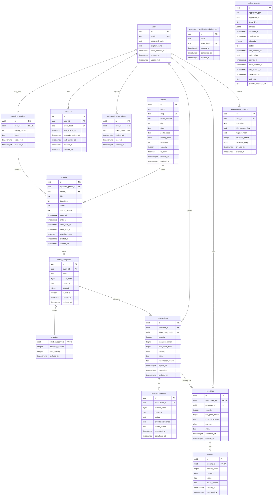

# Entity-Relationship Model

**Status:** Accepted  
**Scope:** Current PostgreSQL Schema (Migrations 00001–00008)

## ER Diagram

> [!NOTE]
> `registration_verification_challenges` stores verification tokens keyed by email address and intentionally has no foreign key to `users` because challenges precede user account creation in the email-first registration flow.
> `outbox_events` is an asynchronous transactional outbox keyed by `(aggregate_type, aggregate_id)` and has no direct foreign key constraints.

---

## Implementation Status by Table

To distinguish what is operational in the codebase versus schema-only:

| Table | Status | Description |
| --- | --- | --- |
| `users` | **Implemented** | Account creation on email verification, Argon2id password hash verification, unique normalized email constraint. |
| `sessions` | **Implemented** | Stateful session persistence, SHA-256 token hashing, idle & absolute expiry, sliding idle refresh, revocation timestamp. |
| `registration_verification_challenges` | **Implemented** | Challenge generation, encrypted outbox payload delivery, hash lookup, 24h expiration, single-use `consumed_at`. |
| `outbox_events` | **Implemented** | Outbox pattern persistence, batch claim with leases (`claim_token`, `claim_expires_at`), retry backoff with jitter, dead-letter `failed` marking. |
| `password_reset_tokens` | **Schema-only** | Table and constraints exist (migration 00002, 00007). Reset initiation and completion service logic not yet implemented. |
| `organizer_profiles` | **Schema-only** | Table exists (migration 00002, 00007). Organizer onboarding endpoints and profile creation service not yet implemented. |
| `venues` | **Schema-only** | Table exists (migration 00003), sqlc queries exist (`venues.sql`), but API routes and catalog service are pending. |
| `events` | **Schema-only** | Table with GiST exclusion constraint exists (migration 00004), sqlc queries exist (`events.sql`), service/routes pending. |
| `ticket_categories` | **Schema-only** | Table exists (migration 00004), service/routes pending. |
| `inventory` | **Schema-only** | Table exists (migration 00004), inventory allocation/release service pending. |
| `reservations` | **Schema-only** | Table exists (migration 00005), reservation hold and expiration service pending. |
| `payment_attempts` | **Schema-only** | Table exists (migration 00005), payment simulation service pending. |
| `bookings` | **Schema-only** | Table exists (migration 00005), booking confirmation service pending. |
| `refunds` | **Schema-only** | Table exists (migration 00005), refund simulation and retry worker pending. |
| `idempotency_records` | **Schema-only** | Table exists (migration 00006), idempotency middleware pending. |

---

## Modeling Notes

### Users, Authentication, and Sessions

- **Email-first registration:** Accounts are created only after the customer completes registration with a valid verification challenge. The `users` table therefore contains only verified users (`email_verified_at` is `NOT NULL DEFAULT now()`).
- **Normalized emails:** Enforced via `CONSTRAINT chk_users_email_normalized CHECK (email = lower(trim(email)) AND length(email) > 0)` and `uq_users_email UNIQUE (email)`.
- **Sessions:** Stateful sessions store a 64-character hex SHA-256 hash of the 256-bit secure random cookie token. They enforce both a 30-minute idle expiration and a 7-day absolute lifetime (`chk_sessions_expiry_order CHECK (absolute_expires_at >= idle_expires_at)`). Revocation is tracked via `revoked_at timestamptz`.
- **Challenges:** `registration_verification_challenges` tracks unauthenticated email challenges with a 64-character token hash, 24-hour expiration, and single-use `consumed_at`.

### Organizer Profiles

- A user can have zero or one organizer profile via a `UNIQUE` foreign key on `user_id`.
- Every registered user can act as a customer. An organizer profile grants event-management capabilities.
- Status values are constrained to `('active', 'suspended')`.

### Venues

- Venues are platform-managed catalog entries and are not owned by organizers.
- A venue stores name, unique URL slug, structured address fields (`street_address`, `city`, `state`, `postal_code`, `country_code`), IANA timezone (validated via PostgreSQL `now() AT TIME ZONE timezone IS NOT NULL`), physical capacity, and active status (`is_active`).
- Postal code is validated as 6 digits (`^[0-9]{6}$`), and country code is `'IN'`.
- A composite unique index on `(lower(trim(name)), lower(trim(city)))` prevents duplicate venue records.
- Deactivating a venue does not cancel existing scheduled events.

### Events and Scheduling

- Each event references exactly one organizer profile and one venue with `ON DELETE RESTRICT`.
- The persisted event lifecycle states are `active` and `cancelled`.
- Booking availability states are `open` and `paused`.
- `schedule_range` is a stored generated column: `tstzrange(starts_at, ends_at, '[)')`.
- Venue scheduling conflicts are prevented at the database level by a GiST exclusion constraint (`events_venue_no_overlap EXCLUDE USING gist (venue_id WITH =, schedule_range WITH &&) WHERE (status = 'active')`).
- Event completion is derived from time (`now() >= ends_at`) and is not a persisted column status.

### Ticket Categories and Inventory

- Each ticket category belongs to an event.
- Currency is constrained to `'INR'`, and prices are stored in minor units (`price_minor bigint >= 0`).
- Each ticket category has a 1:1 `inventory` row with `reserved_quantity` and `sold_quantity`.
- Derived available quantity: `capacity - reserved_quantity - sold_quantity`.
- The aggregate invariant `SUM(ticket_categories.capacity) <= venues.capacity` must be enforced transactionally.

### Reservations, Payment Attempts, Bookings, and Refunds

- `reservations` track temporary holds (status: `'held'`, `'confirmed'`, `'expired'`, `'cancelled'`). A partial index `idx_reservations_active_expiry` supports finding expired held reservations efficiently.
- `payment_attempts` preserve history of simulated payments (`'pending'`, `'succeeded'`, `'failed'`). Multiple attempts can link to one reservation.
- `bookings` originate from a reservation via a `UNIQUE` foreign key on `reservation_id`, guaranteeing at most one booking per reservation.
- `refunds` track cancellation refunds via a `UNIQUE` foreign key on `booking_id`, guaranteeing at most one refund record per booking.

### Idempotency Records and Outbox Events

- `idempotency_records` enforce uniqueness on `(user_id, operation, idempotency_key)` to guarantee safe client retries.
- `outbox_events` implements the transactional outbox pattern. Status transitions: `'pending'` -> `'processing'` (with lease token/expiry) -> `'published'` or `'failed'`. Filtered indexes support claiming pending events and recovering expired leases.

---

## Important Database Invariants

1. Every event references an existing active venue and organizer profile.
2. Non-cancelled events at the same venue cannot have overlapping scheduled intervals (`events_venue_no_overlap`).
3. Total allocated capacity across an event's ticket categories must not exceed venue physical capacity.
4. Available inventory must never become negative (`reserved_quantity >= 0`, `sold_quantity >= 0`).
5. A reservation can produce at most one confirmed booking (`bookings.reservation_id UNIQUE`).
6. A booking can produce at most one refund record (`refunds.booking_id UNIQUE`).
7. Session token hashes are 64-character lowercase hexadecimal strings (`chk_sessions_token_hash`).
8. Sessions cannot authenticate if expired (`idle_expires_at <= now()` or `absolute_expires_at <= now()`) or revoked (`revoked_at IS NOT NULL`).
9. Registration challenges cannot be consumed twice (`consumed_at IS NULL` check upon consumption).
10. Outbox processing leases guarantee exclusive single-worker processing per event batch.
