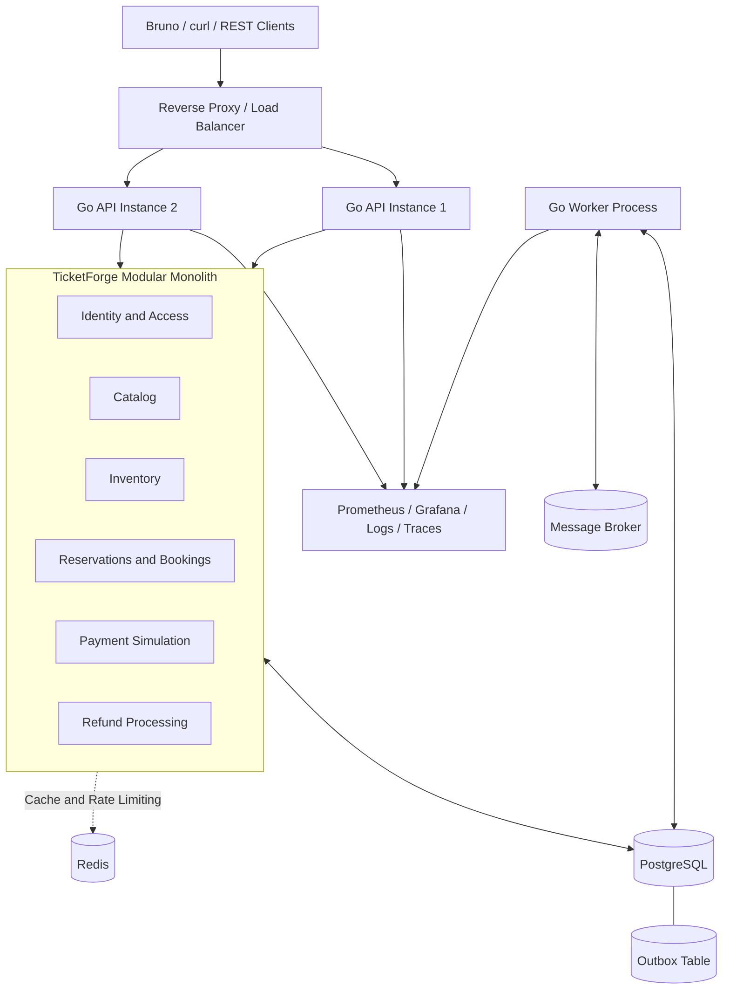

# High-Level Design (HLD)

**Status:** Accepted

## 1. Architectural Goals

- Start with a modular monolith.
- Keep business logic separate from HTTP and infrastructure concerns.
- Use PostgreSQL as the source of truth.
- Separate API and worker process entry points when needed.
- Introduce infrastructure incrementally.
- Support multiple API instances without depending on in-memory shared state.
- Enforce inventory correctness and venue scheduling constraints across all API instances.
- Make asynchronous payment-refund and event-processing workflows recoverable.

## 2. Architecture Style

Initial architecture: Modular Monolith.

The application uses one Go codebase with cohesive internal modules.

It can run as separate process types:

- **API process:** Handles REST requests.
- **Worker process:** Handles background processing.
- **Outbox publisher:** Initially runs as part of the worker process.

Infrastructure:

- **PostgreSQL:** Authoritative persistent storage.
- **Redis:** Caching and rate limiting.
- **Message broker:** Asynchronous event transport.
- **Prometheus:** Metrics collection.
- **Grafana:** Metrics visualization.

## 3. High-Level Architecture Diagram

The outbox is a table inside PostgreSQL, not a separate infrastructure service.

The diagram represents the target architecture. Some components will be introduced only in later implementation phases.

## 4. Logical Modules

### Identity and Access

Responsibilities:

- User registration.
- Authentication.
- Organizer profiles.
- Authorization.
- Resource ownership.

Every registered user has customer capabilities. Organizer capabilities are granted through an organizer profile.

Organizer activation is immediate in the initial version.

### Catalog

Responsibilities:

- Platform-managed venue catalog.
- Event management.
- Ticket category management.
- Event publication lifecycle.
- Venue scheduling validation.
- Venue capacity validation.

Organizers can select existing venues but cannot freely create or modify venue records through the application.

Each event belongs to one organizer and references one venue.

The catalog must prevent overlapping non-cancelled events at the same venue.

### Inventory

Responsibilities:

- Availability queries.
- Inventory allocation.
- Inventory release.
- Inventory invariants.
- Concurrency control.

PostgreSQL is authoritative for inventory.

### Booking

Responsibilities:

- Reservation creation.
- Reservation expiration.
- Booking confirmation.
- Reservation cancellation.
- Idempotency coordination.
- Historical price snapshots.

### Payment Simulation

Responsibilities:

- Simulated payment attempts.
- Success and failure outcomes.
- Payment attempt persistence.
- Payment retries while a reservation remains eligible.

Failed payment attempts are retained.

### Refund Processing

Responsibilities:

- Initiating refunds after event cancellation.
- Recording simulated refund outcomes.
- Retrying failed refunds.
- Preventing duplicate refunds.

### Asynchronous Processing

Responsibilities:

- Transactional outbox.
- Outbox publishing.
- Reservation expiration.
- Event consumers.
- Refund processing.
- Retry handling.
- Event cancellation processing.

### Observability

Responsibilities:

- Structured logging.
- Metrics.
- Tracing.
- Health checks.
- Operational diagnostics.

## 5. Deployment Evolution

### Initial Setup

Docker Compose runs PostgreSQL.

The Go API can run directly on Fedora using `go run` during early development.

The initial venue catalog is populated through seed data.

### Caching Phase

Add Redis to Docker Compose.

Use it for selected caching and rate-limiting requirements.

### Messaging Phase

Add a message broker.

Introduce the outbox publisher and worker process.

### Observability Phase

Add Prometheus and Grafana.

Instrument the API, database interactions, and workers.

### Multi-Instance Phase

Run multiple API instances behind a reverse proxy.

All API instances share PostgreSQL and the required infrastructure.

Correctness must not depend on sticky sessions or process-local memory.

## 6. Important Architectural Rules

1. PostgreSQL enforces inventory correctness.
2. PostgreSQL enforces venue scheduling correctness.
3. Redis is not the authoritative inventory store.
4. Broker availability must not be required to commit a normal reservation.
5. Outbox events are committed atomically with their corresponding business changes.
6. Consumers assume at-least-once delivery.
7. Workers must be safe to retry.
8. API shutdown must allow in-flight requests to finish within a configured deadline.
9. Worker shutdown must stop claiming new work and safely finish or release claimed work.
10. Event cancellation must be durable even if refund processing is temporarily unavailable.
11. Refund processing must be idempotent.
12. Price changes must not modify existing reservation or booking amounts.

## 7. Initial Technology Direction

| Concern | Technology |
| --- | --- |
| Language | Go |
| API | REST over HTTP |
| Database | PostgreSQL |
| Local infrastructure | Docker Compose |
| Cache and rate limiting | Redis |
| Messaging | To be selected |
| Migrations | Versioned SQL migrations |
| API testing | Bruno and curl |
| Metrics | Prometheus |
| Dashboards | Grafana |
| Load testing | To be selected |
| Reverse proxy | To be selected |

## 8. Decisions Deferred Until Implementation

- Go HTTP router.
- Database access approach.
- PostgreSQL migration tool.
- Message broker.
- Redis client.
- Authentication strategy.
- Reverse proxy.
- Exact deployment topology.
- Exact PostgreSQL venue-overlap constraint.
- Worker claiming and retry strategy for refunds.

These decisions should be made when their corresponding implementation phases approach and recorded as ADRs when consequential.
