# High-Level Design (HLD)

**Status:** Accepted

## Architectural Goals

- Start with a modular monolith.
- Keep business logic separate from HTTP and infrastructure concerns.
- Use PostgreSQL as the source of truth.
- Separate API and worker process entry points.
- Introduce infrastructure incrementally.
- Support multiple API instances without depending on in-memory shared state.
- Enforce inventory correctness, venue scheduling, and venue capacity constraints across all API instances.
- Make asynchronous workflows recoverable and safe to retry.
- Keep the initial implementation understandable and avoid premature distributed-system complexity.

## Architecture Style

Initial architecture: **Modular Monolith**.

The application uses one Go codebase with cohesive internal modules.

It can run as separate process types:

- **API process:** Handles REST requests.
- **Worker process:** Handles background processing.
- **Outbox publisher:** Initially runs as part of the worker process.

Infrastructure:

- **PostgreSQL:** Authoritative persistent storage.
- **Redis:** Caching and rate limiting.
- **Message broker:** Asynchronous event transport; implementation choice remains open.
- **Prometheus:** Metrics collection.
- **Grafana:** Metrics visualization.

The API and worker are separate process entry points, but they share the same application codebase and domain logic.

## High-Level Architecture Diagram

```mermaid
flowchart TB
    Client[Bruno / curl / REST Clients]

    Proxy[Reverse Proxy / Load Balancer]

    API1[Go API Instance 1]
    API2[Go API Instance 2]

    subgraph Application["TicketForge Modular Monolith"]
        Identity[Identity and Access]
        Catalog[Catalog]
        Inventory[Inventory]
        Booking[Reservations and Bookings]
        Payment[Payment Simulation]
        Refund[Refund Processing]
    end

    DB[(PostgreSQL)]
    Redis[(Redis)]
    Broker[(Message Broker)]
    Worker[Go Worker Process]

    OutboxTable[(Outbox Table)]
    Obs[Prometheus / Grafana / Logs / Traces]

    Client --> Proxy
    Proxy --> API1
    Proxy --> API2

    API1 --> Application
    API2 --> Application

    Application <--> DB
    Application -. Cache and Rate Limiting .-> Redis

    DB --- OutboxTable
    Worker <--> DB
    Worker <--> Broker

    API1 --> Obs
    API2 --> Obs
    Worker --> Obs
```

The diagram represents the target architecture. Some components will be introduced only in later implementation phases.

The outbox is a table inside PostgreSQL, not a separate infrastructure service.

The worker process initially hosts:

- Reservation expiration.
- Refund processing.
- Outbox publishing.
- Other asynchronous consumers introduced later.

The broker is not required for a normal reservation transaction to commit. Business changes and their corresponding outbox records are committed together in PostgreSQL.

## Logical Modules

### Identity and Access

*(Implemented)*

Responsibilities:

- Email-first user registration challenge issuance and verification.
- Password hashing and verification using Argon2id.
- Stateful session creation, storage, and validation.
- Session authentication middleware (sliding 30-min idle timeout, 7-day absolute lifetime).
- Session revocation on logout.
- AES-256-GCM encryption of outbox payloads using a versioned KeyRing.
- Authorization and resource ownership context (`UserFromContext`).

Every registered user has customer capabilities. Organizer capabilities are granted through an organizer profile (schema exists; profile creation endpoint is pending).

Email verification is required before account creation: users do not exist in the database until completing registration with a valid verification challenge.

### Catalog

*(Schema-only)*

Responsibilities:

- Platform-managed venue catalog.
- Event creation and management.
- Event rescheduling and cancellation.
- Ticket category management.
- Booking availability controls.
- Venue scheduling validation.
- Venue capacity validation.

Venues, events, and ticket categories have database schemas and sqlc queries generated, but HTTP handlers and service layer are pending implementation.

### Inventory

*(Schema-only)*

Responsibilities:

- Availability queries.
- Inventory allocation.
- Inventory release.
- Inventory invariants.
- Concurrency control.

PostgreSQL schema exists (`inventory` table tracking `reserved_quantity` and `sold_quantity`). Service logic pending implementation.

### Booking

*(Schema-only)*

Responsibilities:

- Reservation creation.
- Reservation expiration.
- Booking confirmation.
- Reservation cancellation.
- Idempotency coordination.
- Historical price snapshots.

Schema exists (`reservations`, `bookings`). Service logic pending implementation.

### Payment Simulation

*(Schema-only)*

Responsibilities:

- Simulated payment attempts.
- Success and failure outcomes.
- Payment attempt persistence.
- Payment retries while a reservation remains eligible.

Schema exists (`payment_attempts`). Service logic pending implementation.

### Refund Processing

*(Schema-only)*

Responsibilities:

- Creating refund records during event cancellation.
- Processing pending refunds.
- Recording simulated refund outcomes.
- Retrying failed refunds.
- Preventing duplicate refund operations.

Schema exists (`refunds`). Service logic pending implementation.

### Asynchronous Processing

*(Implemented for Outbox & Transactional Email; Planned for Event Broker & Refunds)*

Responsibilities:

- Transactional outbox pattern.
- Outbox worker process with batch leasing (`claim_token`, `claim_expires_at`).
- Exponential backoff retry with jitter and max-attempt failure handling.
- SMTP transactional email dispatch (Mailpit in development per ADR-013).
- Reservation expiration worker (planned).
- Asynchronous refund worker (planned).
- External message broker transport (planned).

The transactional outbox ensures that business changes and corresponding event records are committed atomically.

The outbox publisher sends committed records to the message broker.

Delivery is treated as at least once. Consumers must therefore be idempotent.

Workers must safely claim work, revalidate state, and tolerate retries and process crashes.

Reservation expiration and event cancellation coordinate through database transactions. Event cancellation itself does not defer Held reservation invalidation to a background worker.

### Observability

Responsibilities:

- Structured logging.
- Metrics.
- Tracing.
- Health checks.
- Operational diagnostics.

Prometheus collects metrics from API instances and workers.

Grafana provides dashboards for application behavior and infrastructure health.

Important signals include:

- HTTP request count, latency, and error rates.
- Reservation attempts and outcomes.
- Inventory conflicts.
- Reservation expiration lag.
- Venue scheduling conflicts.
- Database connection pool utilization.
- Worker processing duration.
- Pending refund count and oldest pending refund age.
- Outbox backlog and oldest unpublished event age.
- Broker publishing failures.
- Consumer retries and dead-letter counts.

Sensitive information such as passwords, session tokens, and unnecessary personal information must not be logged.

## Deployment Evolution

### Initial Setup

Run PostgreSQL 18 using a local container through Compose.

The Go API can run directly on Fedora during early development.

The initial venue catalog is populated through seed data.

Database schema changes are managed through versioned SQL migrations.

The initial database access approach uses:

- `pgx/v5` and `pgxpool` for PostgreSQL connectivity.
- `sqlc` for type-safe query code generation.
- Goose for SQL migrations.

### Caching Phase

Add Redis to the local container environment.

Use it for selected caching and rate-limiting requirements.

Redis is optional for business correctness. Its unavailability must not allow inventory overselling or violate other PostgreSQL invariants.

### Messaging Phase

Add a message broker.

Introduce the outbox publisher and worker process.

Use the transactional outbox pattern to reliably publish events resulting from committed database transactions.

The specific broker remains an implementation decision.

### Observability Phase

Add Prometheus and Grafana.

Instrument the API, database interactions, and workers.

Introduce structured logging and tracing as needed.

### Multi-Instance Phase

Run multiple API instances behind a reverse proxy.

All API instances share PostgreSQL and the required infrastructure.

Correctness must not depend on sticky sessions or process-local memory.

Stateful authentication sessions are persisted in PostgreSQL, allowing requests to be handled by different API instances.

## Important Architectural Rules

1. PostgreSQL is the source of truth for business-critical state.
2. PostgreSQL enforces venue scheduling correctness through exclusion constraints.
3. Inventory allocation and release must be transactionally correct.
4. Aggregate venue-capacity constraints must be protected through transactional coordination.
5. Redis is not the authoritative inventory store.
6. Broker availability must not be required to commit a normal reservation.
7. Outbox events are committed atomically with their corresponding business changes.
8. Consumers assume at-least-once delivery.
9. Consumers and workers must be safe to retry.
10. API shutdown must allow in-flight requests to finish within a configured deadline.
11. Worker shutdown must stop claiming new work and safely finish or release claimed work.
12. Event cancellation must be durable even if refund processing is temporarily unavailable.
13. Event cancellation synchronously invalidates Held reservations and releases their inventory.
14. Refund processing must be idempotent.
15. Refund processing must not restore sold inventory.
16. Price changes must not modify existing reservation or booking amounts.
17. Authorization must enforce organizer ownership at the resource level.
18. Multiple API instances and workers must coordinate through shared persistent state, not process-local locks.

## Initial Technology Direction

| Concern | Technology | Decision |
| --- | --- | --- |
| Language | Go | Selected & Implemented |
| API Routing | `net/http` ServeMux (Go 1.22+) | Selected & Implemented |
| Database | PostgreSQL 18 | Selected & Implemented |
| PostgreSQL driver | pgx/v5 and pgxpool | Selected & Implemented |
| Query generation | sqlc | Selected & Implemented |
| Migrations | Goose | Selected & Implemented |
| Local infrastructure | Docker Compose | Selected & Implemented |
| Authentication | Email-first registration, Argon2id, stateful sessions in PostgreSQL | Selected & Implemented |
| Session transport | Secure HTTP cookies (HttpOnly, SameSite=Lax) | Selected & Implemented |
| Password hashing | Argon2id | Selected & Implemented |
| Token encryption | AES-256-GCM with versioned KeyRing | Selected & Implemented |
| Asynchronous outbox worker | Polling PostgreSQL outbox with batch leasing | Selected & Implemented |
| Email delivery | SMTP (Mailpit for dev/test, Resend for prod) | Selected & Implemented |
| Cache and rate limiting | PostgreSQL & Redis | Planned |
| Messaging | Message broker | Planned |
| API testing | Bruno, curl, Go integration tests | Selected & Implemented |
| Metrics | Prometheus | Planned |
| Dashboards | Grafana | Planned |
| Load testing | To be selected | Planned |
| Reverse proxy | To be selected | Planned |

## Decisions Deferred Until Implementation

The following decisions remain open and should be made when their corresponding implementation phases approach:

- Message broker selection.
- Redis client selection.
- Reverse proxy and load balancer selection.
- Exact deployment topology.
- Load-testing tool.
- Outbox retention and cleanup policy.
- Consumer deduplication strategy.
- Detailed database locking strategy for aggregate venue capacity.
- Detailed database locking and lock-order strategy across reservation, confirmation, cancellation, and expiration operations.
- Operational procedures for failed refunds and dead-letter messages.

Consequential architectural decisions should be recorded as ADRs.

## Implementation Philosophy

Build the system incrementally.

Start with PostgreSQL-backed business functionality and establish correctness before introducing additional infrastructure.

A sensible implementation progression is:

1. Database schema, migrations, and query generation.
2. Identity and access.
3. Venue and event management.
4. Ticket categories and inventory.
5. Reservations and booking confirmation.
6. Simulated payments and refunds.
7. Transactional outbox and background workers.
8. Redis integration where justified.
9. Message broker integration.
10. Observability and load testing.
11. Multiple API instances behind a reverse proxy.

Each phase should preserve the established business invariants rather than introducing infrastructure merely for architectural appearance.
