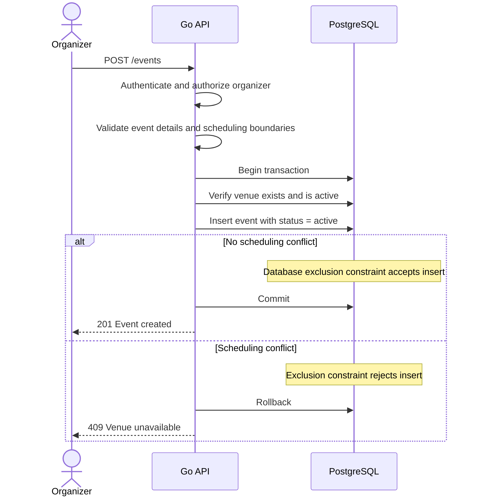
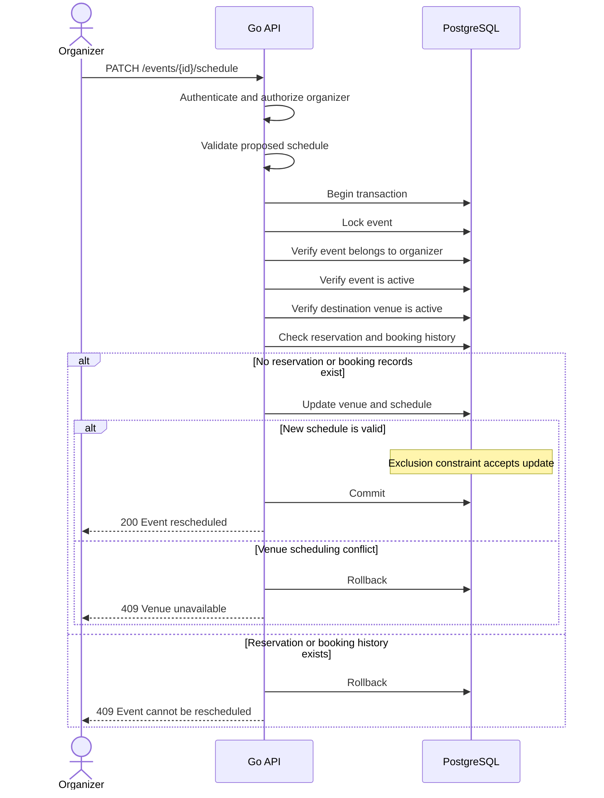
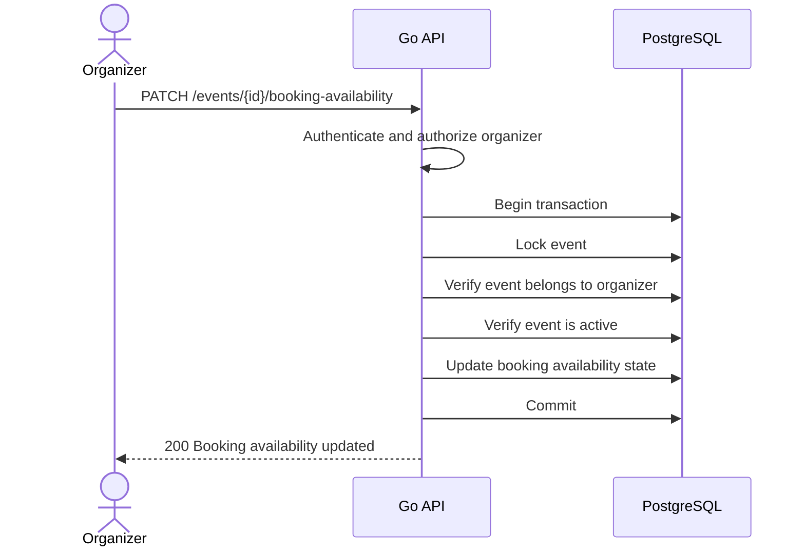
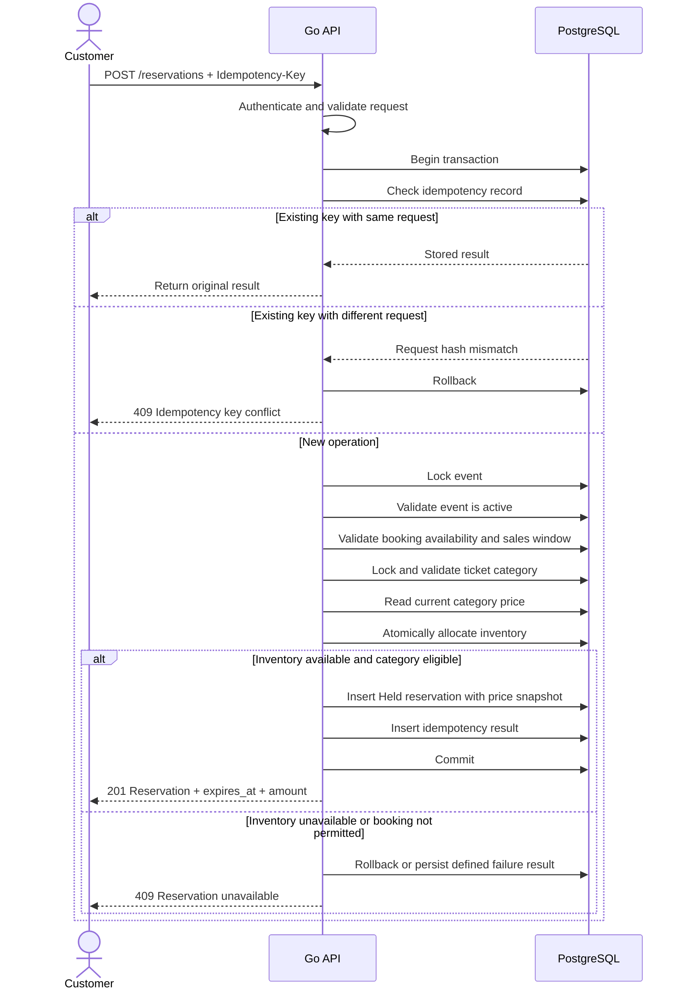
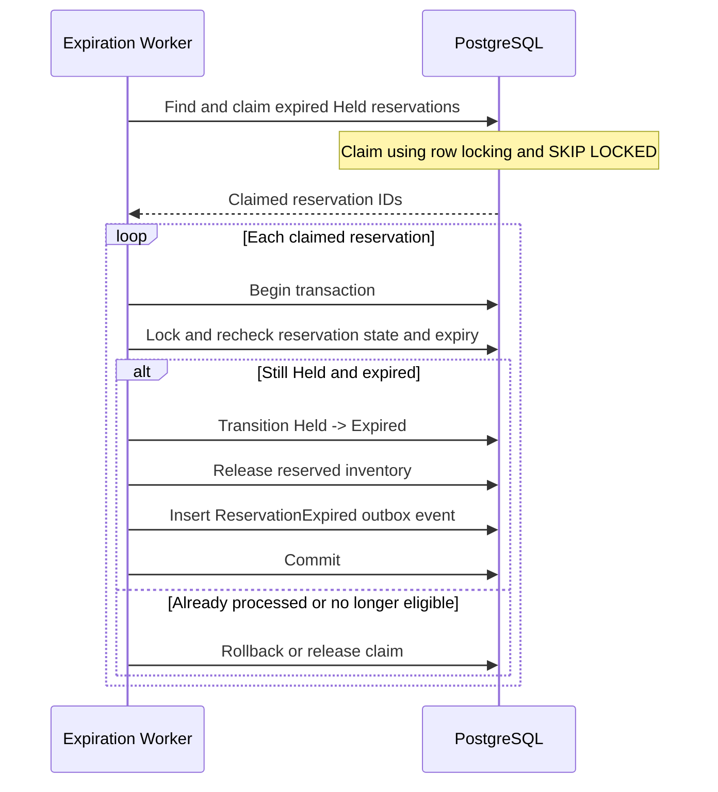
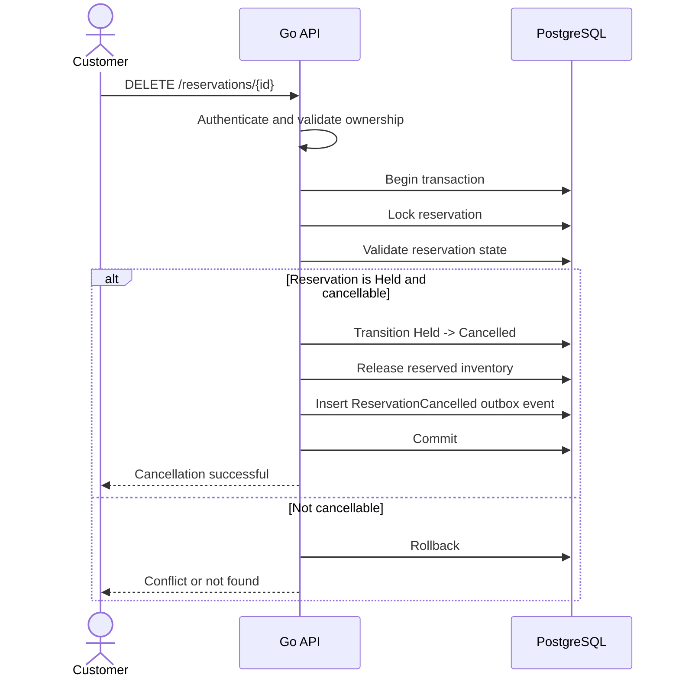
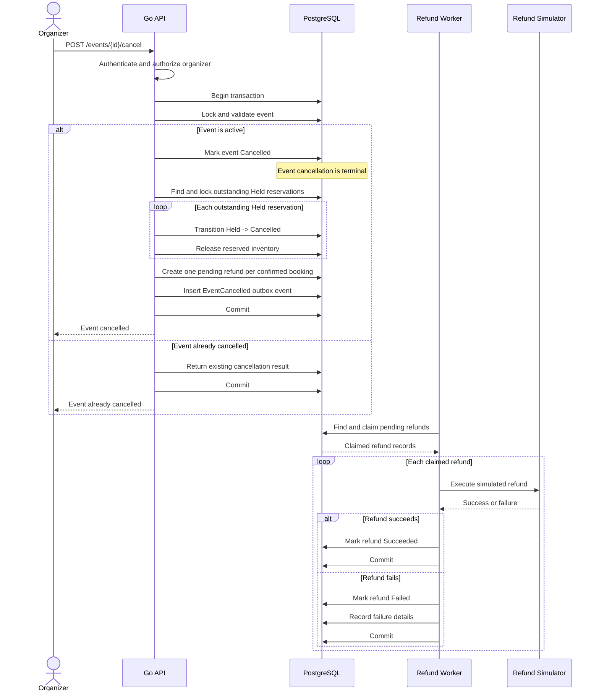
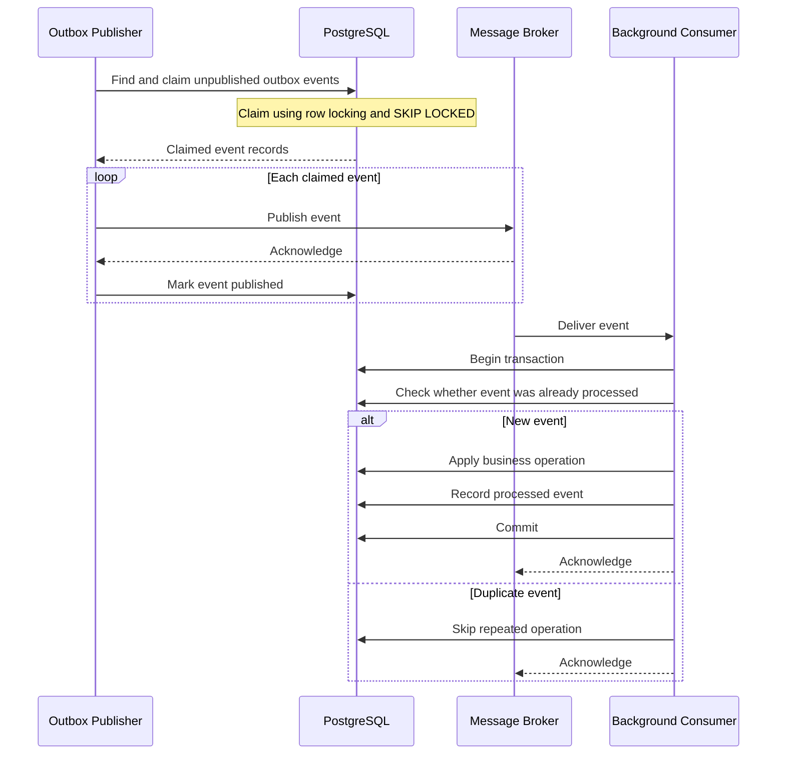

# Critical Sequence Diagrams

**Status:** Accepted  
**Scope:** General-admission ticketing

## Create Event and Validate Venue Availability

**Important design considerations:**

- Events are created directly with the `active` lifecycle status.
- There is no Draft or Published event state.
- Event creation must validate the scheduling boundaries:
  - Start at least 15 minutes in the future.
  - Start no more than one calendar year in the future.
  - Duration between 15 minutes and 7 days.
- Only active venues can be selected.
- The scheduled interval is half-open: `[starts_at, ends_at)`.
- Only active events participate in venue conflict checks.
- The application must not rely solely on a separate availability query followed by an insert.

A simple `SELECT` followed by `INSERT` is insufficient because two organizers could simultaneously observe that a venue is available.

The database must enforce the non-overlapping schedule invariant. PostgreSQL range types and exclusion constraints using GiST are the intended approach.

The exact database implementation will be finalized during SQL schema design.

## Reschedule Event

**Important design considerations:**

- Rescheduling is allowed only if the event has never had any reservation or booking.
- Any reservation record blocks rescheduling, including expired and cancelled reservations.
- Any confirmed booking blocks rescheduling, including subsequently refunded bookings.
- Reservation records must be retained for this historical check and future auditing.
- No separate historical marker is required.
- Cancelled events cannot be rescheduled.
- The destination venue must be active.
- The new schedule must satisfy all event scheduling constraints and venue-overlap rules.

The event row must be locked during the operation.

Reservation creation must coordinate through the same event-level locking strategy. This prevents a reservation from being created concurrently while the event is being rescheduled.

The database exclusion constraint remains the final authority for venue scheduling conflicts.

## Change Booking Availability

**Important design considerations:**

Booking availability is separate from the event lifecycle.

The persisted booking availability states are:

- `open`
- `paused`

The default state is `open`.

When booking availability is paused:

- New reservations are rejected.
- Existing Held reservations remain eligible for payment until their original expiry, provided all other confirmation conditions are satisfied.
- Reservation expiry is not extended.
- Reservation expiration continues normally.

Effective booking availability is derived from:

1. Event lifecycle.
2. Booking availability state.
3. Sales start time.
4. Sales end time.
5. Remaining inventory.

Pausing booking availability must not invalidate existing Held reservations.

Event cancellation is different: it prevents both new reservations and confirmations.

## Reserve Tickets

The reservation stores the price applicable at creation time.

A later ticket category price change must not affect this reservation.

The initial reservation duration is two minutes.

The expiration timestamp is determined by server-side policy and must not be extended by payment retries.

**Important design considerations:**

- The event must be active.
- Booking availability must be `open`.
- The sales window must permit new reservations.
- The ticket category must be active.
- Sufficient inventory must be available.
- Event cancellation, rescheduling, and reservation creation must coordinate through event-level locking.
- Inventory allocation must be atomic.
- The database must remain the source of truth for inventory.

The exact inventory locking or atomic-update strategy will be finalized during SQL and application design.

## Confirm Reservation

**Important design considerations:**

- A failed payment attempt is retained.
- A failed attempt does not release inventory.
- The reservation remains Held if it is still eligible.
- Payment retries do not extend the original expiration time.
- Only one successful confirmation can create a booking.
- The reservation price snapshot determines the amount charged.
- Confirmation must not succeed after event cancellation.
- Confirmation must be coordinated with event cancellation and reservation expiration.
- A paused booking availability state does not prevent confirmation of an otherwise eligible Held reservation.
- Confirmation must check event lifecycle, not merely booking availability.

The initial simulator is local and does not involve a real external payment provider. Its execution and transaction boundary will be finalized during low-level design.

Do not hold a database transaction open across a real external payment provider call in a future integration. A real payment workflow would need to handle callbacks, uncertain outcomes, and reconciliation.

## Expire Reservations

The worker must safely handle multiple instances processing the same expiration workload.

The reservation state transition and inventory release must occur in one transaction.

Only a successful transition from Held to Expired may release reserved inventory.

If a customer cancellation, event cancellation, or confirmation has already changed the reservation state, the expiration worker must not release the inventory again.

`FOR UPDATE SKIP LOCKED` is a possible mechanism for allowing multiple workers to claim separate batches without waiting on one another.

The exact claiming and batching strategy will be finalized during worker implementation.

## Cancel Reservation

**Important design considerations:**

- Customers can cancel their own eligible Held reservations.
- Confirmed bookings cannot be individually cancelled in the initial version.
- Inventory release must occur in the same transaction as the reservation state transition.
- Only a successful Held-to-Cancelled transition releases inventory.
- Reservation records are retained after cancellation.
- The operation must be safe when racing with expiration or event cancellation.

## Cancel Event and Initiate Refunds

**Important design considerations:**

- Event cancellation and Held reservation invalidation happen in one database transaction.
- The event becomes cancelled permanently.
- Outstanding Held reservations are invalidated and their reserved inventory is released exactly once.
- Confirmation must not succeed after event cancellation.
- New reservations must not be accepted after event cancellation.
- Refund records are created for confirmed bookings as part of the cancellation transaction.
- The initial release supports one refund record per booking.
- A unique constraint on `refunds.booking_id` prevents duplicate refund records.
- Refund execution happens asynchronously.
- The cancellation transaction does not wait for refund execution.
- Refund retries operate on the existing refund record.
- A failed refund must not reactivate the event.
- Refunding a booking does not restore sold inventory.
- A booking remains a historical record after it has been refunded.

Creating the refund records in the cancellation transaction ensures that every confirmed booking has durable refund work associated with the cancellation before the transaction commits.

The refund worker can then claim pending refund records and process them independently.

The exact refund status transitions, retry policy, and simulated provider idempotency strategy will be finalized during low-level design.

## Publish Outbox Events

**Important design considerations:**

- Business changes and their corresponding outbox records must be committed in the same database transaction.
- The publisher must safely handle multiple instances.
- The publisher can crash after publishing but before marking the event as published.
- Consequently, duplicate message delivery is possible.
- Consumers must be idempotent.
- A message must not be acknowledged before its business operation is durably committed.
- The outbox is the durable record of work that still needs publication.

This design provides reliable at-least-once publication rather than assuming exactly-once message delivery.

The exact event schema, claiming strategy, and consumer deduplication mechanism will be finalized during asynchronous processing design.

## Important Implementation Questions

The following questions remain for low-level design:

- Which concurrency-control strategy protects inventory?
- What consistent row-locking order should reservation creation, confirmation, cancellation, and event rescheduling follow?
- How are idempotency records committed atomically with business operations?
- Should failed idempotency responses be stored?
- How do multiple workers safely claim expiration jobs?
- How do we enforce venue non-overlap at the database level?
- How should venue-capacity and ticket-category-capacity changes be coordinated with inventory operations?
- What happens if an event is published but the publisher crashes before marking it published?
- How do consumers persist deduplication records?
- How do refund workers claim and retry refund operations safely?
- What API status codes and error formats should be standardized?
- How will simulated payment and refund outcomes be deterministic in tests?
- What retry limits and dead-letter handling should apply to asynchronous operations?
