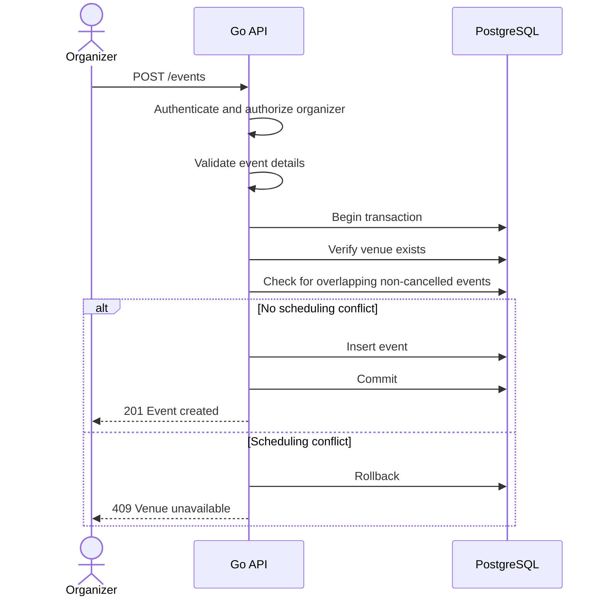
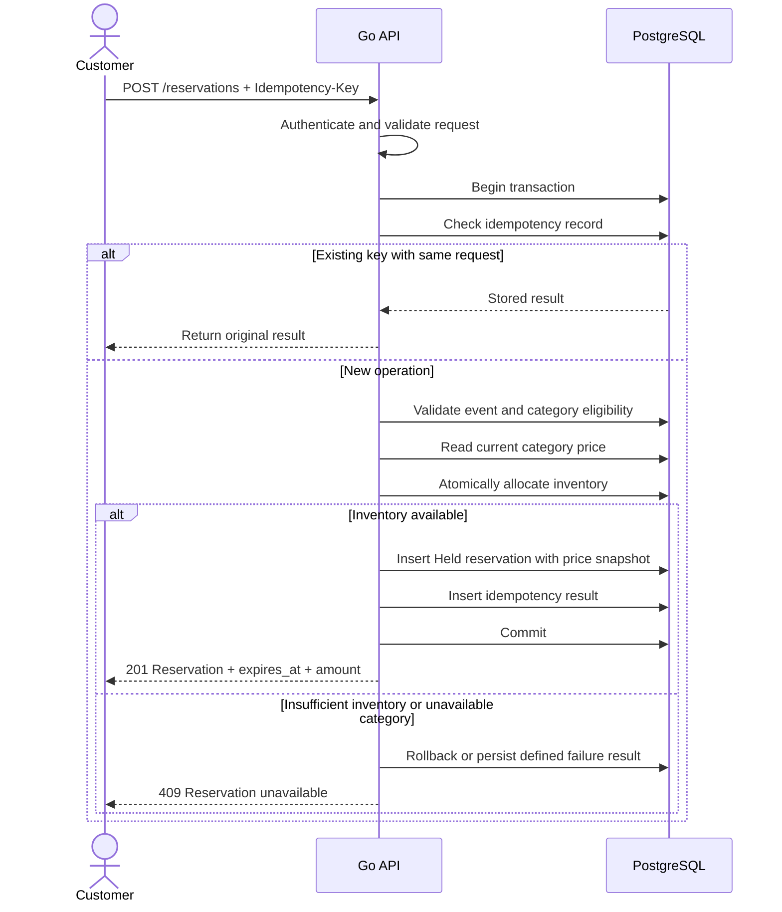
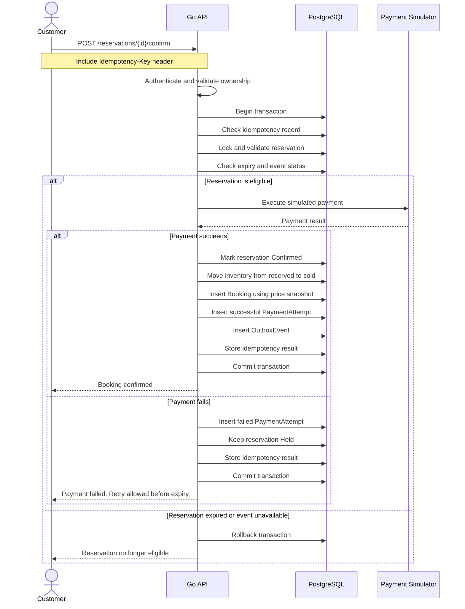
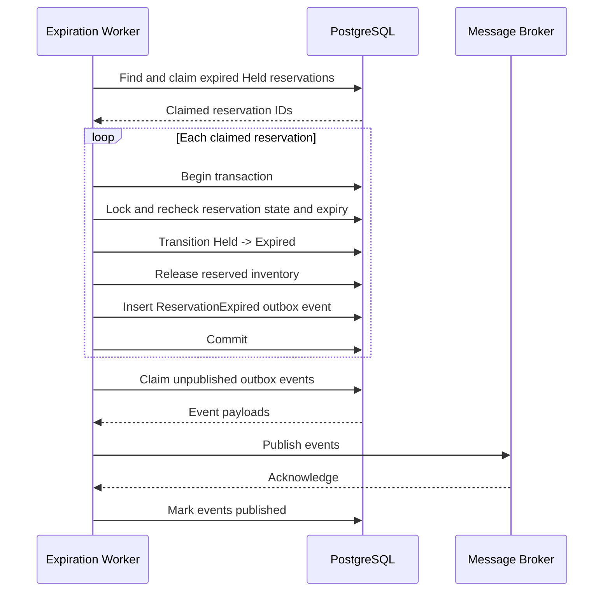
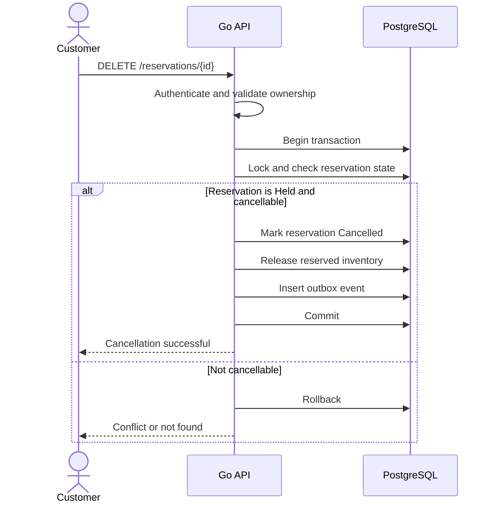
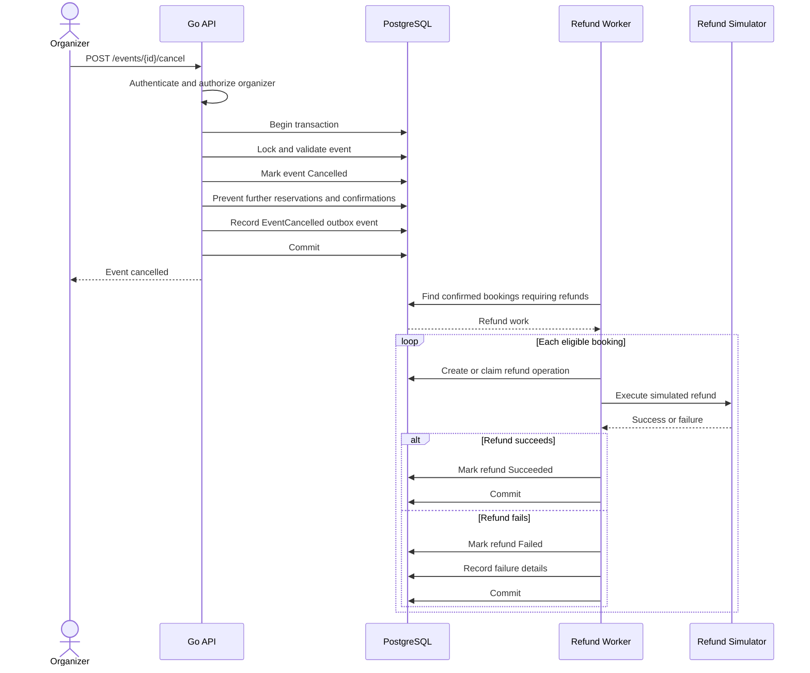

# Critical Sequence Diagrams

**Status:** Accepted

## 1. Create Event and Validate Venue Availability

**Important design consideration:**

The availability check and event insertion must be protected against concurrent event creation.

A simple `SELECT` followed by `INSERT` is insufficient because two organizers could simultaneously observe that a venue is available.

The database must enforce the non-overlapping schedule invariant. PostgreSQL range types and exclusion constraints are one possible solution.

The exact database implementation will be decided during SQL schema design.

## 2. Reserve Tickets

The reservation stores the price applicable at creation time.

A later ticket category price change must not affect this reservation.

The initial reservation expiry is two minutes after creation.

## 3. Confirm Reservation

**Important design considerations:**

- A failed payment attempt is retained.
- A failed attempt does not release inventory.
- The reservation remains Held if it is still eligible.
- Payment retries do not extend the original expiration time.
- Only one successful confirmation can create a booking.
- The reservation price snapshot determines the amount charged.

The initial simulator is local. We will finalize whether its execution occurs inside the database transaction during low-level design.

Do not hold a database transaction open across a real external payment provider call in a future integration. A real payment workflow would need to handle callbacks, uncertain outcomes, and reconciliation.

## 4. Expire Reservations

The worker must safely handle multiple instances processing the same expiration workload.

The reservation state transition and inventory release must occur in one transaction.

## 5. Cancel Reservation

Confirmed bookings cannot be individually cancelled in the initial version.

## 6. Cancel Event and Initiate Refunds

**Important design considerations:**

- Event cancellation must be committed independently of refund completion.
- Refund processing can happen asynchronously.
- A failed refund must be retryable.
- Repeated event cancellation or message delivery must not create duplicate refunds.
- A cancelled event must remain cancelled even when refund processing fails.
- The exact refund uniqueness and retry strategy will be finalized during low-level design.

## 7. Important Implementation Questions

- Which concurrency-control strategy protects inventory?
- How are idempotency records committed with business operations?
- How do multiple workers safely claim expiration jobs?
- How do we enforce venue non-overlap at the database level?
- What happens if an event is published but the publisher crashes before marking it published?
- How do refund workers claim and retry refund operations safely?
- What API status codes and error formats should be standardized?
- How will simulated payment and refund outcomes be deterministic in tests?
