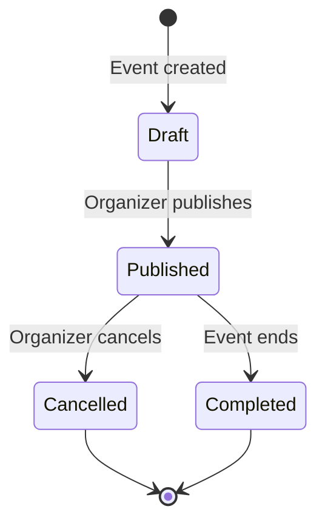
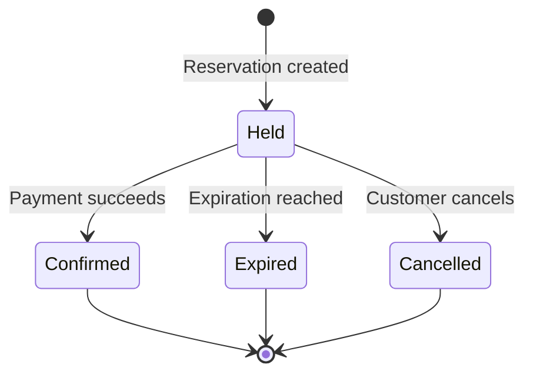
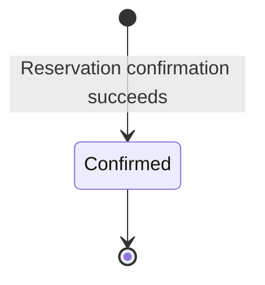
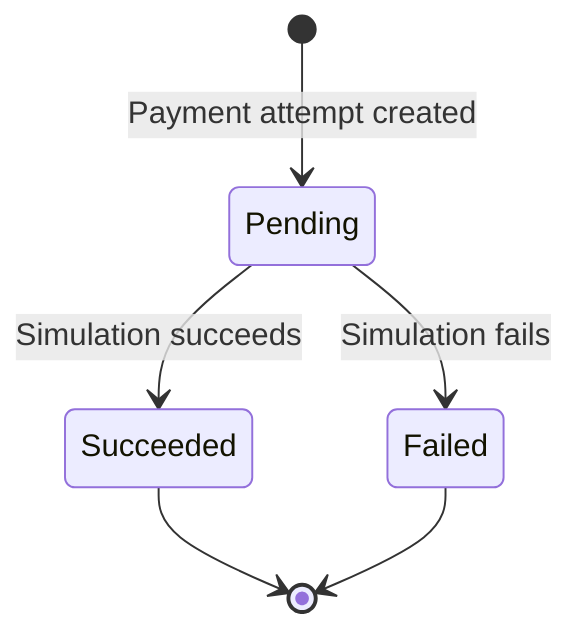
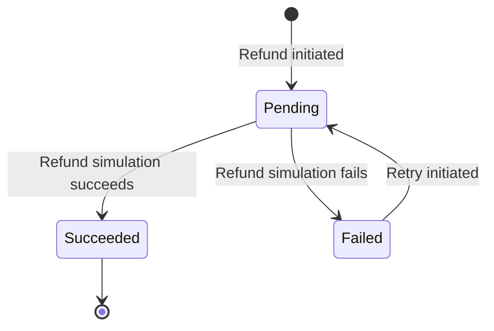

# State Machines

**Status:** Accepted

## 1. Event Lifecycle



### Event States

| State | Meaning |
| --- | --- |
| Draft | Event is being configured and is not publicly bookable |
| Published | Event is publicly available according to its booking window |
| Cancelled | Organizer cancelled the event |
| Completed | Event has ended |

### Rules

- An event must reference an existing platform-managed venue.
- An event belongs to exactly one organizer.
- An event must have a valid start and end time.
- Only non-cancelled events participate in venue scheduling conflicts.
- Publishing requires at least one bookable ticket category.
- A cancelled event cannot accept new reservations or confirmations.
- Event cancellation initiates refunds for confirmed bookings.
- Event cancellation does not wait for refund completion.

## 2. Reservation Lifecycle



### Reservation States

| State | Meaning |
| --- | --- |
| Held | Inventory is temporarily reserved |
| Confirmed | Reservation has become a confirmed booking |
| Expired | Reservation expired without confirmation |
| Cancelled | Held reservation was cancelled |

### Rules

- Held reservations consume reserved inventory.
- Confirmed reservations become sold inventory.
- Expired and cancelled Held reservations release held inventory.
- A reservation cannot be confirmed after expiration.
- The initial reservation duration is two minutes.
- Expiration is determined by server-side policy.
- Payment retries do not extend expiration.
- Failed payment attempts leave an otherwise eligible reservation Held.
- A reservation can produce at most one confirmed booking.
- Terminal states cannot be reactivated.

Confirmed bookings cannot be individually cancelled in the initial version.

## 3. Booking Lifecycle



A booking is created only after successful reservation confirmation.

Individual booking cancellation is not supported in the initial version.

If the associated event is cancelled, a refund is initiated. The booking remains a historical record of the confirmed allocation.

Refund status is tracked separately.

## 4. Simulated Payment Lifecycle



A reservation may have multiple payment attempts.

Example:

```text
Reservation
    |
    ├── PaymentAttempt 1: Failed
    ├── PaymentAttempt 2: Failed
    └── PaymentAttempt 3: Succeeded
```

### Rules

- Every payment attempt is recorded separately.
- A failed attempt does not automatically release inventory.
- The reservation remains Held if it is still eligible.
- The customer may retry before expiration.
- A successful payment can confirm the reservation only once.
- A payment attempt cannot succeed for an expired or otherwise ineligible reservation.

## 5. Refund Lifecycle



### Rules

- Event cancellation initiates refunds for confirmed bookings.
- The initial version uses simulated refunds.
- Refund outcomes are persisted.
- Failed refunds can be retried.
- A successful refund must not be executed more than once for the same refund operation.
- Refund failure does not reactivate the event.
- Refund state is separate from booking state.

## 6. Inventory Accounting

For each ticket category:

available = capacity - reserved_quantity - sold_quantity

Expected transitions:

| Operation | Reserved | Sold | Available |
| --- | ---: | ---: | ---: |
| New hold of Q | +Q | unchanged | -Q |
| Confirm hold of Q | -Q | +Q | unchanged |
| Expire hold of Q | -Q | unchanged | +Q |
| Cancel Held reservation Q | -Q | unchanged | +Q |

Individual confirmed-booking cancellation is not supported initially.

When an event is cancelled, new booking activity is prevented. The exact inventory treatment for already confirmed bookings is a historical accounting concern and must not be confused with refund processing.

Every inventory transition must occur atomically with the corresponding reservation or booking state transition.

## 7. Venue Scheduling Invariant

A venue may host multiple events, but non-cancelled event intervals must not overlap.

For two event intervals A and B, an overlap exists when:

A.start < B.end AND B.start < A.end

Intervals are treated as half-open:

[start, end)

Therefore, an event ending at 15:00 and another beginning at 15:00 do not overlap.

A cancelled event no longer occupies the venue schedule.

The invariant must hold under concurrent event creation, not merely during an application-level availability check.

## 8. Concurrency and Transition Guards

Important race conditions:

### Confirmation vs Expiration

A customer may confirm a reservation at almost the same moment the worker attempts to expire it.

Only one transition must win.

### Reservation Cancellation vs Expiration

A customer may cancel a reservation while a worker is expiring it.

Inventory must be released exactly once.

### Duplicate Worker Execution

Multiple workers must not expire and release inventory for the same reservation twice.

### Duplicate API Requests

Repeated confirmation requests must not create duplicate bookings.

### Concurrent Venue Scheduling

Two organizers may attempt to schedule overlapping events at the same venue.

Only one scheduling operation must succeed.

### Event Cancellation vs Confirmation

An organizer may cancel an event while a customer is attempting to confirm a reservation.

The system must prevent a booking from being confirmed after event cancellation has taken effect.

### Duplicate Refund Processing

Multiple workers or repeated messages must not cause the same refund to be executed more than once.

## 9. Decisions Finalized

- Reservation duration: two minutes.
- Failed payment: reservation remains Held while eligible.
- Payment retries: allowed until reservation expiry.
- Individual confirmed-booking cancellation: unsupported.
- Event cancellation: refunds initiated for confirmed bookings.
- Refund processing: simulated and retryable.
- Venue scheduling: overlapping non-cancelled events are prohibited.
