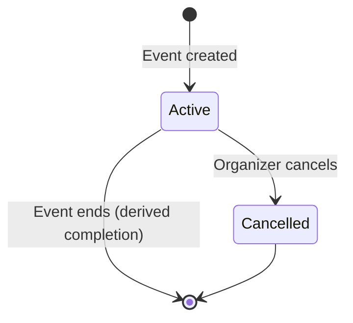
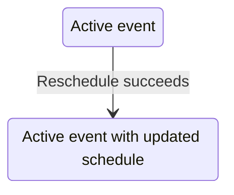
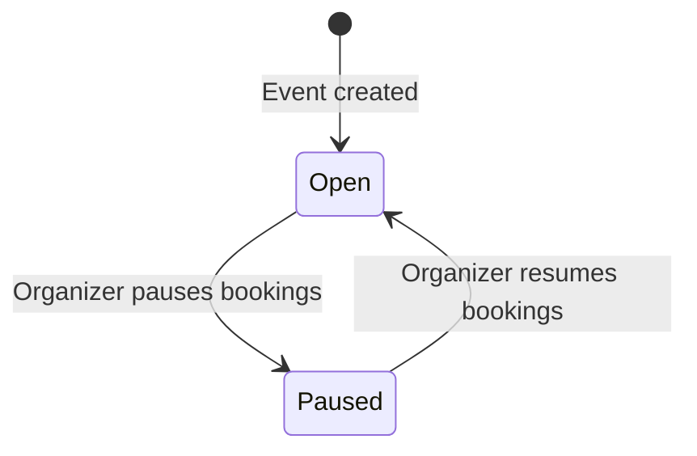
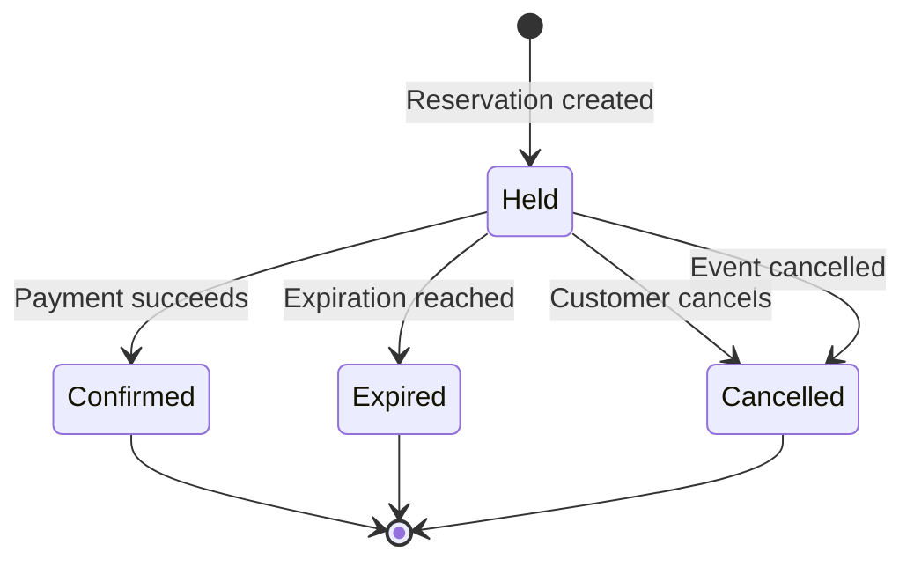
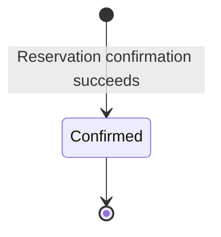
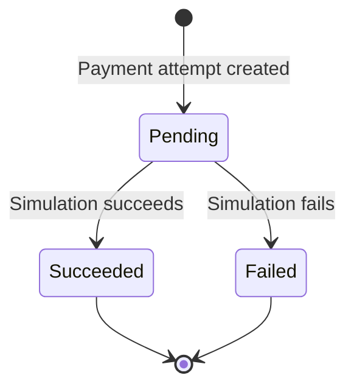
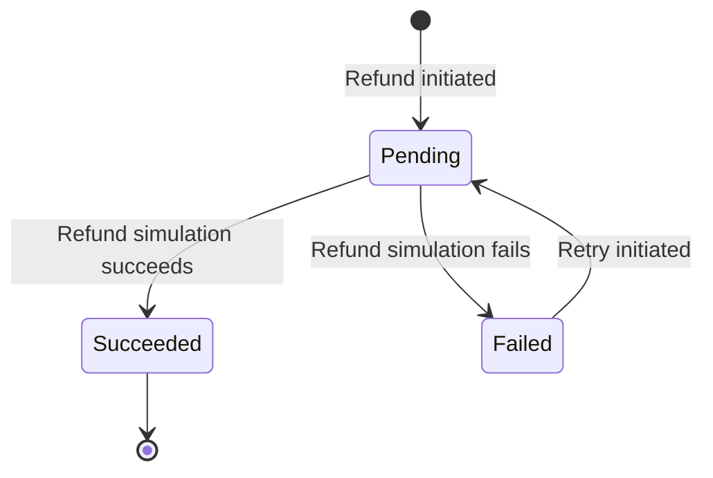

# State Machines

**Status:** Accepted

## Event Lifecycle

An event is created directly in the `active` state. It does not have Draft or Published states.

Completion is derived from the event's schedule and is not a persisted lifecycle state.



### Event States

| State | Meaning |
| --- | --- |
| `active` | Event exists and has not been cancelled. It may be bookable depending on its booking availability, sales window, and inventory. |
| `cancelled` | Organizer cancelled the event. This is a terminal state. |

An active event is considered completed when the current time reaches or passes its `ends_at` timestamp. Its persisted status remains `active`.

### Rules

- An event references exactly one existing platform-managed venue.
- An event belongs to exactly one organizer.
- An event must have a valid start and end time.
- An event is created directly as `active`.
- An active event may have zero or more ticket categories. Having no categories does not prevent event creation.
- An active event does not necessarily mean that reservations are currently accepted.
- A cancelled event cannot accept new reservations or confirmations.
- A cancelled event cannot be reactivated. The organizer must create a new event instead.
- Event cancellation initiates refunds for confirmed bookings.
- Event cancellation does not wait for refund processing to finish.
- Event completion is derived from `ends_at`; no persisted `completed` state is required.

### Event Rescheduling

Rescheduling changes an active event's `starts_at`, `ends_at`, and optionally its venue.



Rules:

- Only active events can be rescheduled.
- An event can be rescheduled only if it has never had any reservation or booking associated with it.
- This includes expired and cancelled reservations, not just currently held reservations.
- Reservation records are retained; they are not physically deleted to make an event eligible for rescheduling.
- The destination venue must be active.
- The new schedule must satisfy the event scheduling constraints.
- The venue scheduling exclusion constraint is authoritative.
- Rescheduling must be coordinated transactionally with reservation creation so that a reservation cannot race with a schedule change.

## Booking Availability

Booking availability is separate from the event lifecycle.

It controls whether new reservations may be created for an event.



### Booking Availability States

| State | Meaning |
| --- | --- |
| `open` | The organizer has not paused new reservations. Other booking conditions still apply. |
| `paused` | New reservations are temporarily blocked. |

### Effective Availability

The effective availability shown to customers is derived from multiple conditions. It is not a single persisted state.

The evaluation order is:

1. Event is `cancelled` → Cancelled
2. Booking availability is `paused` → Paused
3. Current time is before `sales_start_at` → Not started
4. Current time is at or after `sales_end_at` → Ended
5. All relevant inventory is exhausted → Sold out
6. Otherwise → Available

### Rules

- Booking availability defaults to `open`.
- Pausing bookings prevents new reservations.
- Pausing bookings does not invalidate existing Held reservations.
- Existing Held reservations may still be confirmed before their original expiration, provided all other confirmation conditions remain satisfied.
- Pausing bookings does not extend reservation expiration.
- Reservation expiration continues normally while bookings are paused.
- Event cancellation overrides booking availability and blocks all new reservations and confirmations.

## Reservation Lifecycle



### Reservation States

| State | Meaning |
| --- | --- |
| `held` | Inventory is temporarily reserved for the customer. |
| `confirmed` | Reservation confirmation succeeded and a booking was created. |
| `expired` | Reservation expired without confirmation. |
| `cancelled` | A Held reservation was cancelled by the customer or invalidated by event cancellation. |

### Rules

- A Held reservation consumes reserved inventory.
- A Confirmed reservation has become a booking and its quantity counts as sold inventory.
- Expired and cancelled Held reservations release their reserved inventory.
- A reservation cannot be confirmed after expiration.
- The initial reservation duration is two minutes.
- Expiration is determined by server-side policy.
- Payment retries do not extend expiration.
- Failed payment attempts leave an otherwise eligible reservation Held.
- A reservation can produce at most one booking.
- Terminal reservation states cannot be reactivated.
- Reservation records are retained after expiration or cancellation.

### Event Cancellation and Held Reservations

When an event is cancelled:

- Every outstanding Held reservation is transitioned to `cancelled`.
- Its reserved inventory is released.
- These transitions and inventory updates happen synchronously in the event cancellation transaction.
- A delayed payment callback must not confirm a reservation belonging to a cancelled event.

## Booking Lifecycle



A booking is created only after successful reservation confirmation.

### Rules

- A reservation can create at most one booking.
- Individual confirmed-booking cancellation is not supported in the initial version.
- If the associated event is cancelled, a refund is initiated.
- The booking remains a historical record of the confirmed allocation.
- Refund status is tracked separately from booking state.
- A successful refund does not change the booking's historical confirmation state.
- Refunding a booking does not restore sold inventory.

## Simulated Payment Lifecycle



A reservation may have multiple payment attempts.

Example:

```text
Reservation
    |
    ├── PaymentAttempt 1: Failed
    ├── PaymentAttempt 2: Failed
    └── PaymentAttempt 3: Succeeded
```

### Rules

- Every payment attempt is recorded separately.
- A failed attempt does not automatically release inventory.
- The reservation remains Held if it is still eligible.
- The customer may retry before expiration.
- A successful payment can confirm the reservation only once.
- A payment attempt cannot successfully confirm an expired, cancelled, or otherwise ineligible reservation.
- Confirmation must also verify that the associated event is still active.
- Confirmation must be coordinated with event cancellation so that a booking cannot be confirmed after cancellation has taken effect.

## Refund Lifecycle



### Rules

- Event cancellation initiates a refund for every confirmed booking associated with the event.
- The initial version uses simulated refunds.
- Refund records are created as part of the event cancellation transaction.
- Refund processing happens asynchronously.
- Refund outcomes are persisted.
- Failed refunds can be retried using the existing refund record.
- There is at most one refund record per booking.
- A successful refund must not be executed more than once for the same refund operation.
- Refund processing must be idempotent.
- Refund failure does not reactivate the event.
- Refund state is separate from booking state.
- Refund processing does not restore sold inventory.

## Inventory Accounting

For each ticket category:

```text
available = capacity - reserved_quantity - sold_quantity
```

Expected transitions:

| Operation | Reserved | Sold | Available |
| --- | ---: | ---: | ---: |
| New hold of Q | +Q | unchanged | -Q |
| Confirm hold of Q | -Q | +Q | unchanged |
| Expire hold of Q | -Q | unchanged | +Q |
| Cancel Held reservation of Q | -Q | unchanged | +Q |
| Refund confirmed booking | unchanged | unchanged | unchanged |

### Rules

- `capacity` belongs to the ticket category; it is not duplicated in the inventory record.
- Held reservations contribute to `reserved_quantity`.
- Confirmed bookings contribute to `sold_quantity`.
- Expiration and cancellation of Held reservations release reserved inventory exactly once.
- Confirmation moves inventory from reserved to sold without changing available inventory.
- Refunds do not restore sold inventory.
- Individual confirmed-booking cancellation is not supported initially.
- Event cancellation releases inventory for outstanding Held reservations.
- Confirmed bookings remain part of historical sold inventory, even after refunds.
- Every inventory transition must occur atomically with the corresponding reservation or booking state transition.

The inventory invariant is:

```text
reserved_quantity >= 0
sold_quantity >= 0
reserved_quantity + sold_quantity <= capacity
```

The sum of ticket category capacities for an event must not exceed the venue's physical capacity.

## Venue Scheduling Invariant

A venue may host multiple events, but active event intervals must not overlap.

For two event intervals A and B, an overlap exists when:

```text
A.start < B.end AND B.start < A.end
```

Intervals are treated as half-open:

```text
[start, end)
```

Therefore, an event ending at 15:00 and another beginning at 15:00 do not overlap.

### Rules

- Only active events occupy the venue schedule.
- Cancelled events no longer occupy the venue schedule.
- An active event continues occupying its schedule even if its venue is subsequently deactivated.
- Venue deactivation does not automatically cancel existing events.
- The invariant must hold under concurrent event creation and rescheduling, not merely during an application-level availability check.
- PostgreSQL exclusion constraints are the authoritative protection against overlapping schedules.
- Application-level availability checks may provide early feedback but cannot guarantee correctness.

## Concurrency and Transition Guards

Important race conditions must be handled through transactions, appropriate row locking, constraints, and idempotent operations.

### Confirmation vs Expiration

A customer may confirm a reservation at almost the same moment the expiration worker attempts to expire it.

Only one transition must win. Inventory must be updated according to that winning transition.

### Reservation Cancellation vs Expiration

A customer may cancel a reservation while a worker is expiring it.

Only one operation may transition the reservation out of Held and release its inventory.

### Duplicate Worker Execution

Multiple workers must not expire and release inventory for the same reservation twice.

Workers must safely claim work and recheck the reservation's state and expiration before applying a transition.

### Duplicate API Requests

Repeated confirmation requests must not create duplicate bookings or apply inventory transitions more than once.

### Concurrent Venue Scheduling

Two organizers may attempt to schedule overlapping events at the same venue.

Only one scheduling operation must succeed. The database exclusion constraint is authoritative.

### Event Cancellation vs Confirmation

An organizer may cancel an event while a customer is attempting to confirm a reservation.

The system must coordinate both operations so that:

- If confirmation wins first, the booking is created and the event cancellation must account for it when initiating refunds.
- If cancellation wins first, confirmation must fail and the Held reservation must be invalidated.

### Event Cancellation vs Reservation Creation

Event cancellation must coordinate with reservation creation.

A new reservation must not be created after event cancellation has taken effect.

### Event Rescheduling vs Reservation Creation

Rescheduling must coordinate with reservation creation.

If a reservation is created first, the event must no longer qualify for rescheduling. If rescheduling succeeds first, subsequent reservations use the updated event schedule.

### Duplicate Refund Processing

Multiple workers or repeated messages must not cause the same refund operation to execute more than once.

Refund processing must use persisted state and idempotency protections.

## Decisions Finalized

- Event creation state: `active`.
- Event cancellation state: `cancelled`, terminal.
- Event completion: derived from `ends_at`, not persisted.
- Booking availability: separate `open` / `paused` state.
- Pausing bookings: blocks new reservations but does not invalidate existing Held reservations.
- Reservation duration: two minutes.
- Failed payment: reservation remains Held while eligible.
- Payment retries: allowed until reservation expiry.
- Reservation records: retained after expiration and cancellation.
- Individual confirmed-booking cancellation: unsupported.
- Event cancellation: outstanding Held reservations are invalidated synchronously; refunds are initiated for confirmed bookings.
- Refund processing: asynchronous, simulated, persisted, and retryable.
- Refunds do not restore sold inventory.
- Venue scheduling: overlapping active event intervals are prohibited.
- PostgreSQL exclusion constraints enforce venue scheduling correctness.
