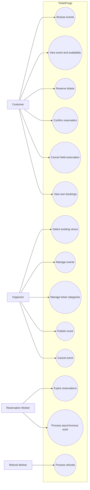

# Actors and Use Cases

**Status:** Accepted

## 1. Actors

### Customer

A registered user who discovers events and manages their own reservations and bookings.

### Organizer

A registered user with an organizer profile.

Organizers manage their own events and select venues from the platform-managed venue catalog.

### Reservation Worker

A background process responsible for reservation expiration and asynchronous processing.

### Refund Worker

A background process responsible for processing and retrying simulated refunds.

### Platform Operator

Responsible for infrastructure and deployment operations. This is not an application-level Admin role.

Platform operators also maintain the initial venue catalog through controlled operational processes.

## 2. Role Model

A registered user can act as a Customer by default.

An Organizer profile grants additional organizer capabilities.

This means:

- A customer can become an organizer.
- An organizer can still book tickets as a customer.
- A user does not need separate customer and organizer accounts.
- Organizer activation is immediate.
- Organizer permissions are enforced at the resource ownership level.
- Each event belongs to exactly one organizer.

## 3. Use-Case Diagram

## 4. Use-Case Details

### UC-01: Register and Authenticate

**Actor:** User

**Preconditions:** User does not already have an account with the submitted identity.

**Main flow:**

1. User submits registration information.
2. API validates the input.
3. Password is securely hashed.
4. User account is persisted.
5. User authenticates and obtains an access credential.

**Failure cases:**

- Invalid input.
- Duplicate email.
- Password policy violation.
- Database failure.

### UC-02: Become an Organizer

**Actor:** Authenticated User

**Main flow:**

1. User requests organizer capabilities.
2. System validates the required organizer information.
3. Organizer profile is created.
4. Organizer capabilities become immediately available.

**Rules:**

- Organizer activation does not require verification in the initial version.
- A user can continue to act as a customer.
- A user can have at most one organizer profile.

**Out of scope:**

- Identity verification.
- Organizer approval.
- Organizer suspension workflows.

### UC-03: Select a Venue

**Actor:** Organizer

**Preconditions:** User has an organizer profile.

**Main flow:**

1. Organizer searches or browses the venue catalog.
2. System returns available venue information.
3. Organizer selects a venue for an event.
4. The selected venue is referenced by the event.

**Rules:**

- Venues are platform-managed.
- Organizers cannot create or modify venue records through the initial application.
- Venue catalog entries are maintained through controlled operational processes.
- Selecting a venue does not guarantee that a requested time interval is available. Scheduling is validated during event creation.

### UC-04: Create and Publish an Event

**Actor:** Organizer

**Preconditions:**

- Organizer has an organizer profile.
- Selected venue exists in the platform-managed catalog.

**Main flow:**

1. Organizer creates an event.
2. Organizer selects a venue.
3. Organizer defines event dates and booking window.
4. System validates the event schedule.
5. System checks for overlapping non-cancelled events at the venue.
6. Organizer creates ticket categories.
7. System validates capacities and prices.
8. Organizer publishes the event.
9. Event becomes publicly discoverable.

**Failure cases:**

- Invalid event schedule.
- Venue does not exist.
- Venue scheduling conflict.
- Invalid ticket category configuration.
- Insufficient or invalid event information.

**Important:** Concurrent event creation must not allow two overlapping events at the same venue.

### UC-05: Manage Ticket Categories and Prices

**Actor:** Organizer

**Preconditions:** Organizer owns the event.

**Main flow:**

1. Organizer creates a ticket category.
2. Organizer sets its name, price, and capacity.
3. System creates the corresponding inventory record.
4. Organizer may later update the category price.
5. New reservations use the updated price.

**Rules:**

- Existing reservations retain their original price.
- Existing bookings retain their historical price.
- Automatic scheduled price tiers are outside the initial scope.

### UC-06: Browse Events

**Actor:** Customer

**Main flow:**

1. Customer requests published events.
2. API returns event summaries.
3. Customer selects an event.
4. API returns event details and ticket categories.
5. API returns current availability.

**Important:** Availability is only a snapshot. A subsequent reservation attempt must revalidate inventory transactionally.

### UC-07: Reserve Tickets

**Actor:** Customer

**Preconditions:**

- Event is published.
- Event booking window is open.
- Event has not been cancelled.
- Ticket category is active.
- Requested quantity is positive.

**Main flow:**

1. Customer submits a reservation request.
2. Request includes an idempotency key.
3. API authenticates the customer.
4. API validates the request.
5. System starts a database transaction.
6. Current ticket category price is read.
7. Inventory is allocated atomically.
8. Reservation is created with a price snapshot.
9. Expiration time is set to two minutes after creation.
10. Idempotency result is persisted.
11. Transaction commits.
12. API returns reservation ID, amount, and expiration time.

**Alternative flows:**

- Insufficient inventory.
- Event unavailable.
- Venue/event cancelled.
- Invalid quantity.
- Duplicate idempotency request.
- Database failure.

### UC-08: Confirm Reservation

**Actor:** Customer

**Preconditions:**

- Reservation belongs to customer.
- Reservation is Held.
- Reservation has not expired.
- Event has not been cancelled.

**Main flow:**

1. Customer submits confirmation.
2. System validates ownership and reservation expiry.
3. Simulated payment is executed.
4. Payment succeeds.
5. Reservation transitions to Confirmed.
6. Booking is created.
7. Inventory moves from reserved to sold.
8. Relevant outbox event is recorded.
9. Transaction commits.
10. API returns booking details.

**Failure flow:**

1. Simulated payment fails.
2. Failed PaymentAttempt is persisted.
3. Reservation remains Held if still eligible.
4. No booking is created.
5. Customer can retry payment before expiration.

**Rules:**

- Payment retries do not extend reservation expiry.
- A reservation can produce at most one booking.
- A reservation cannot be confirmed after it expires.
- A cancelled event cannot be confirmed.

### UC-09: Cancel Held Reservation

**Actor:** Customer

**Preconditions:**

- Reservation belongs to customer.
- Reservation is Held.

**Main flow:**

1. Customer submits cancellation.
2. System verifies ownership.
3. System validates reservation state.
4. Reservation transitions to Cancelled.
5. Inventory is released transactionally.
6. Relevant event is recorded.
7. API returns cancellation result.

**Failure cases:**

- Reservation already expired.
- Reservation already confirmed.
- Reservation already cancelled.
- Reservation belongs to another customer.

Individual confirmed-booking cancellation is unsupported in the initial version.

### UC-10: Cancel Event

**Actor:** Organizer

**Preconditions:**

- Organizer owns the event.
- Event is eligible for cancellation.

**Main flow:**

1. Organizer submits an event cancellation request.
2. API authenticates and authorizes the organizer.
3. System validates the event state.
4. Event transitions to Cancelled.
5. New reservations and confirmations are prevented.
6. Relevant cancellation event is recorded.
7. Transaction commits.
8. API confirms event cancellation.
9. Background processing identifies confirmed bookings requiring refunds.
10. Simulated refunds are initiated and recorded.

**Failure and recovery behavior:**

- Refund processing does not need to complete before the event becomes Cancelled.
- Failed refunds remain recorded and retryable.
- Repeated cancellation requests must not create duplicate refunds.
- The event remains Cancelled even if refund processing fails.

### UC-11: Expire Reservation

**Actor:** Reservation Worker

**Preconditions:** Reservation has passed its expiry time and remains in Held state.

**Main flow:**

1. Worker discovers eligible reservations.
2. Worker claims work safely.
3. Worker starts a transaction.
4. Reservation state is revalidated.
5. Reservation transitions to Expired.
6. Held inventory is released.
7. Outbox event is recorded.
8. Transaction commits.

**Failure cases:**

- Worker crashes.
- Multiple workers claim expiration work.
- Reservation is confirmed or cancelled before processing.
- Database becomes unavailable.

Processing must be safe to retry.

### UC-12: Process Refund

**Actor:** Refund Worker

**Preconditions:** A refund operation exists for a confirmed booking associated with a cancelled event.

**Main flow:**

1. Worker discovers pending or retryable refund work.
2. Worker safely claims the refund operation.
3. Simulated refund is executed.
4. Outcome is persisted.
5. Successful refunds are marked Succeeded.
6. Failed refunds are marked Failed with relevant details.
7. Failed refunds remain eligible for controlled retry.

**Rules:**

- The same refund operation must not execute more than once successfully.
- Duplicate messages must not create duplicate refunds.
- A refund failure must not reactivate the event.

### UC-13: View Booking History

**Actor:** Customer

**Main flow:**

1. Customer requests booking history.
2. API authenticates the customer.
3. API retrieves only that customer's bookings.
4. API returns booking information.

## 5. Excluded Use Cases

- Application-level Admin operations.
- Manual booking overrides by an Admin.
- Real payment capture.
- Real financial refunds.
- Seat-map management.
- Seat selection.
- Individual cancellation of confirmed bookings.
- Organizer verification and approval.
- Organizer-created venue records through the application.
- Automatic scheduled early-bird price changes.
