# Actors and Use Cases

**Status:** Accepted

## Actors

### User

A registered person with an account in TicketForge.

Every user can act as a Customer by default. A user may also have an Organizer profile.

### Customer

A registered user who discovers events and manages their own reservations and bookings.

### Organizer

A registered user with a verified email address and an organizer profile.

Organizers manage their own events, select venues from the platform-managed venue catalog, and manage ticket categories and booking availability.

### Reservation Worker

A background process responsible for reservation expiration and associated asynchronous work.

### Refund Worker

A background process responsible for processing and retrying simulated refunds.

### Outbox Publisher

A background process responsible for publishing persisted outbox events to the message broker.

### Platform Operator

Responsible for infrastructure and deployment operations.

Platform operators also maintain the initial venue catalog through controlled operational processes. This is not an application-level Admin role.

## Role Model

A registered user can act as a Customer by default.

An Organizer profile grants additional organizer capabilities.

This means:

- A customer can become an organizer.
- An organizer can still book tickets as a customer.
- A user does not need separate customer and organizer accounts.
- A user can have at most one organizer profile.
- Organizer activation is immediate after the required email verification and organizer profile creation.
- Organizer permissions are enforced at the resource ownership level.
- Each event belongs to exactly one organizer.
- Organizers can manage only their own events and associated ticket categories.

## Use-Case Diagram

```mermaid
flowchart LR
    User[User]
    Customer[Customer]
    Organizer[Organizer]
    ReservationWorker[Reservation Worker]
    RefundWorker[Refund Worker]
    OutboxPublisher[Outbox Publisher]
    PlatformOperator[Platform Operator]

    subgraph TicketForge
        Register((Register and authenticate))
        BecomeOrganizer((Become an organizer))

        Browse((Browse events))
        View((View event and availability))
        Reserve((Reserve tickets))
        Confirm((Confirm reservation))
        CancelReservation((Cancel Held reservation))
        History((View own bookings))

        SelectVenue((Select existing venue))
        CreateEvent((Create event))
        RescheduleEvent((Reschedule event))
        ManageCategories((Manage ticket categories))
        BookingAvailability((Pause or resume bookings))
        CancelEvent((Cancel event))

        Expire((Expire reservations))
        ProcessRefund((Process refunds))
        PublishOutbox((Publish outbox events))

        MaintainVenues((Maintain venue catalog))
    end

    User --> Register
    User --> BecomeOrganizer

    Customer --> Browse
    Customer --> View
    Customer --> Reserve
    Customer --> Confirm
    Customer --> CancelReservation
    Customer --> History

    Organizer --> SelectVenue
    Organizer --> CreateEvent
    Organizer --> RescheduleEvent
    Organizer --> ManageCategories
    Organizer --> BookingAvailability
    Organizer --> CancelEvent

    ReservationWorker --> Expire
    RefundWorker --> ProcessRefund
    OutboxPublisher --> PublishOutbox
    PlatformOperator --> MaintainVenues
```

## Use-Case Details

### UC-01: Register and Authenticate

**Actor:** User

**Preconditions:** User does not already have an account with the submitted email address.

**Main flow:**

1. User submits registration information.
2. API validates the input.
3. Password is securely hashed using Argon2id.
4. User account is persisted.
5. System creates an email verification token.
6. Verification email is queued for delivery.
7. User verifies their email address.
8. User authenticates using their email and password.
9. System creates a stateful session.
10. User receives the session credential.

**Failure cases:**

- Invalid input.
- Duplicate email.
- Password policy violation.
- Email delivery failure.
- Invalid or expired verification token.
- Database failure.

**Rules:**

- Email verification is required before a user can reserve tickets or activate organizer capabilities.
- An unverified user may register and authenticate.
- Sessions are persisted and can be revoked.
- Session tokens are generated securely; only their hashes are stored.

### UC-02: Become an Organizer

**Actor:** Authenticated User

**Preconditions:**

- User is authenticated.
- User's email address is verified.
- User does not already have an organizer profile.

**Main flow:**

1. User requests organizer capabilities.
2. System validates the required organizer information.
3. Organizer profile is created.
4. Organizer capabilities become immediately available.

**Rules:**

- Organizer activation is immediate after successful profile creation.
- No separate organizer approval process is required in the initial version.
- A user can continue to act as a customer.
- A user can have at most one organizer profile.

**Out of scope:**

- Identity verification.
- Organizer approval.
- Organizer suspension workflows.

### UC-03: Select a Venue

**Actor:** Organizer

**Preconditions:** User has a verified email address and an organizer profile.

**Main flow:**

1. Organizer searches or browses the venue catalog.
2. System returns active venue information.
3. Organizer selects a venue for an event.
4. The selected venue is referenced by the event.

**Rules:**

- Venues are platform-managed.
- Organizers cannot create or modify venue records through the initial application.
- Venue catalog entries are maintained through controlled operational processes.
- Only active venues can be selected for new events or event rescheduling.
- Selecting a venue does not guarantee that a requested time interval is available.
- Scheduling is enforced during event creation or rescheduling.
- Venue capacity places an upper bound on the total allocated ticket category capacity for an event.

### UC-04: Create an Event

**Actor:** Organizer

**Preconditions:**

- Organizer has a verified email address.
- Organizer has an organizer profile.
- Selected venue exists and is active.

**Main flow:**

1. Organizer submits event information.
2. Organizer selects a venue.
3. Organizer defines event dates and the booking window.
4. System validates the event schedule.
5. System validates that the venue is active.
6. System creates the event with status `active` and booking availability `open`.
7. PostgreSQL enforces the venue scheduling exclusion constraint.
8. Event becomes discoverable.

**Failure cases:**

- Invalid event schedule.
- Venue does not exist.
- Venue is inactive.
- Venue scheduling conflict.
- Invalid event information.
- Database constraint violation.

**Rules:**

- Event creation does not require ticket categories to exist.
- An event is created directly as `active`.
- There is no Draft or Published event state.
- Event completion is derived from `ends_at`.
- Event scheduling constraints apply at creation time.
- The database exclusion constraint is authoritative for concurrent scheduling operations.

### UC-05: Reschedule an Event

**Actor:** Organizer

**Preconditions:**

- Organizer owns the event.
- Event is `active`.
- Event has never had any reservation or booking associated with it.
- Destination venue, if changed, is active.

**Main flow:**

1. Organizer submits updated event schedule and optionally a new venue.
2. System authenticates and authorizes the organizer.
3. System locks the event.
4. System verifies that the event is still active.
5. System verifies that no reservation or booking history exists.
6. System validates the new schedule.
7. System validates the destination venue.
8. System updates the event schedule and venue reference.
9. PostgreSQL enforces the venue scheduling exclusion constraint.
10. Transaction commits.
11. API returns the updated event details.

**Failure cases:**

- Organizer does not own the event.
- Event is cancelled.
- Event has an existing or historical reservation.
- Invalid schedule.
- Destination venue is inactive.
- Venue scheduling conflict.
- Concurrent reservation creation.
- Database failure.

**Rules:**

- An event cannot be rescheduled after any reservation or booking has been associated with it.
- Expired and cancelled reservations also prevent rescheduling.
- Reservation records are retained.
- Rescheduling and reservation creation must be coordinated transactionally.
- Cancelled events cannot be rescheduled.

### UC-06: Manage Ticket Categories and Prices

**Actor:** Organizer

**Preconditions:**

- Organizer owns the event.
- Event is active.

**Main flow:**

1. Organizer creates a ticket category.
2. Organizer sets its name, price, and allocated capacity.
3. System validates the category information.
4. System verifies that total allocated category capacity does not exceed venue capacity.
5. System creates the category and its corresponding inventory record.
6. Organizer may later update the category price.
7. New reservations use the updated price.

**Rules:**

- An event may have zero or more ticket categories.
- Ticket category capacity represents allocated inventory, not tickets sold.
- Inventory tracks reserved and sold quantities; it does not duplicate category capacity.
- Existing reservations retain their original price.
- Existing bookings retain their historical price.
- Category capacity cannot be reduced below its committed inventory (`reserved_quantity + sold_quantity`).
- Total allocated capacity across an event's ticket categories cannot exceed the venue's physical capacity.
- Capacity changes must be transactional and coordinated with concurrent reservation and inventory operations.
- Automatic scheduled price tiers are outside the initial scope.

### UC-07: Browse Events

**Actor:** Customer

**Main flow:**

1. Customer requests active events.
2. API returns event summaries.
3. Customer selects an event.
4. API returns event details and ticket categories.
5. API returns current effective booking availability and inventory information.

**Rules:**

- Only active events are included in normal event discovery.
- An active event may have no ticket categories.
- An active event is not necessarily bookable.
- Effective availability is derived from:
  1. Event lifecycle status.
  2. Booking availability state.
  3. Sales start time.
  4. Sales end time.
  5. Remaining inventory.
- Availability is only a snapshot.
- A subsequent reservation attempt must revalidate all conditions transactionally.

### UC-08: Pause or Resume Bookings

**Actor:** Organizer

**Preconditions:**

- Organizer owns the event.
- Event is active.

**Main flow:**

1. Organizer requests to pause or resume bookings.
2. System authenticates and authorizes the organizer.
3. System verifies that the event is active.
4. System updates the booking availability state to `paused` or `open`.
5. Transaction commits.
6. API returns the updated booking availability.

**Rules:**

- Booking availability is separate from event lifecycle.
- The default booking availability is `open`.
- Pausing bookings prevents new reservations.
- Pausing does not invalidate existing Held reservations.
- Existing Held reservations may still be confirmed before their original expiry if otherwise eligible.
- Pausing does not extend reservation expiration.
- Reservation expiration continues normally while bookings are paused.
- Event cancellation overrides booking availability.

### UC-09: Reserve Tickets

**Actor:** Customer

**Preconditions:**

- Customer is authenticated.
- Customer's email address is verified.
- Event is active.
- Booking availability is `open`.
- Current time is within the sales window.
- Ticket category is active.
- Requested quantity is positive.
- Sufficient inventory is available.

**Main flow:**

1. Customer submits a reservation request.
2. Request includes an idempotency key.
3. API authenticates the customer.
4. API validates the request.
5. System starts a database transaction.
6. System coordinates with the event to prevent races with cancellation and rescheduling.
7. System validates event lifecycle and booking availability.
8. System validates the sales window and ticket category.
9. System reads the current ticket category price.
10. Inventory is allocated atomically.
11. Reservation is created with a price snapshot.
12. Expiration time is set to two minutes after creation.
13. Idempotency result is persisted.
14. Relevant outbox event is recorded.
15. Transaction commits.
16. API returns reservation ID, amount, and expiration time.

**Alternative flows:**

- Insufficient inventory.
- Event cancelled.
- Booking availability paused.
- Sales window not open or already ended.
- Ticket category inactive.
- Invalid quantity.
- Duplicate idempotency request.
- Concurrent event cancellation or rescheduling.
- Database failure.

**Rules:**

- A reservation is created in the `held` state.
- Held reservations consume reserved inventory.
- Reservation expiration is determined by server-side policy.
- Retrying the same idempotency key with the same request must not create another reservation.

### UC-10: Confirm Reservation

**Actor:** Customer

**Preconditions:**

- Customer is authenticated.
- Reservation belongs to customer.
- Reservation is Held.
- Reservation has not expired.
- Associated event is active.

**Main flow:**

1. Customer submits confirmation.
2. System authenticates and authorizes the customer.
3. System starts a database transaction.
4. System coordinates with the event and reservation to prevent races with cancellation and expiration.
5. System validates reservation ownership and state.
6. System validates expiration.
7. System validates that the event is still active.
8. Simulated payment is executed.
9. Payment succeeds.
10. Reservation transitions to `confirmed`.
11. Booking is created.
12. Inventory moves from reserved to sold.
13. Relevant outbox event is recorded.
14. Transaction commits.
15. API returns booking details.

**Failure flow:**

1. Simulated payment fails.
2. Failed PaymentAttempt is persisted.
3. Reservation remains Held if still eligible.
4. No booking is created.
5. Customer can retry payment before expiration.

**Rules:**

- Payment retries do not extend reservation expiry.
- A reservation can produce at most one booking.
- A reservation cannot be confirmed after it expires or is cancelled.
- A cancelled event cannot be confirmed.
- Pausing bookings does not prevent confirmation of an otherwise eligible Held reservation.
- Confirmation and event cancellation must be coordinated so that only one operation wins the relevant race.
- The initial simulated payment implementation must not introduce an external payment-provider call inside an open database transaction.

### UC-11: Cancel Held Reservation

**Actor:** Customer

**Preconditions:**

- Customer is authenticated.
- Reservation belongs to customer.
- Reservation is Held.

**Main flow:**

1. Customer submits cancellation.
2. System verifies ownership.
3. System starts a database transaction.
4. System validates reservation state.
5. Reservation transitions to `cancelled`.
6. Inventory is released transactionally.
7. Relevant outbox event is recorded.
8. Transaction commits.
9. API returns cancellation result.

**Failure cases:**

- Reservation already expired.
- Reservation already confirmed.
- Reservation already cancelled.
- Reservation belongs to another customer.
- Concurrent expiration or event cancellation.
- Database failure.

**Rules:**

- Only Held reservations can be cancelled by the customer.
- Inventory must be released exactly once.
- Reservation records are retained.
- Individual confirmed-booking cancellation is unsupported in the initial version.

### UC-12: Cancel Event

**Actor:** Organizer

**Preconditions:**

- Organizer owns the event.
- Event is active.

**Main flow:**

1. Organizer submits an event cancellation request.
2. API authenticates and authorizes the organizer.
3. System starts a database transaction.
4. System locks the event and validates its state.
5. Event transitions to `cancelled`.
6. New reservations and confirmations are prevented.
7. All outstanding Held reservations are identified and locked.
8. Each Held reservation transitions to `cancelled`.
9. Reserved inventory is released for each invalidated reservation.
10. A pending refund record is created for every confirmed booking that requires a refund.
11. Relevant event cancellation outbox event is recorded.
12. Transaction commits.
13. API confirms event cancellation.
14. Refund Worker processes the pending refunds asynchronously.

**Failure and recovery behavior:**

- Event cancellation, Held reservation invalidation, inventory release, and refund record creation must commit atomically.
- The cancellation transaction does not wait for simulated refund execution.
- Failed refunds remain recorded and retryable.
- Repeated cancellation requests must not create duplicate refunds.
- The event remains cancelled even if refund processing fails.
- Delayed payment callbacks cannot confirm reservations after cancellation has taken effect.

### UC-13: Expire Reservation

**Actor:** Reservation Worker

**Preconditions:** Reservation has passed its expiry time and remains in Held state.

**Main flow:**

1. Worker discovers eligible reservations.
2. Worker claims work safely, allowing multiple workers to operate concurrently.
3. Worker starts a transaction.
4. Reservation state and expiry are revalidated.
5. Reservation transitions to `expired`.
6. Held inventory is released.
7. Outbox event is recorded.
8. Transaction commits.

**Failure cases:**

- Worker crashes.
- Multiple workers attempt to process the same reservation.
- Reservation is confirmed or cancelled before processing.
- Database becomes unavailable.

**Rules:**

- Processing must be safe to retry.
- Inventory must be released exactly once.
- Worker execution must not reactivate terminal reservations.

### UC-14: Process Refund

**Actor:** Refund Worker

**Preconditions:** A pending or retryable refund record exists for a confirmed booking associated with a cancelled event.

**Main flow:**

1. Worker discovers pending or retryable refund work.
2. Worker safely claims the refund operation.
3. Simulated refund is executed.
4. Outcome is persisted.
5. Successful refunds are marked `succeeded`.
6. Failed refunds are marked `failed` with relevant details.
7. Failed refunds remain eligible for controlled retry.

**Rules:**

- There is at most one refund record per booking.
- Retries operate on the existing refund record.
- The same refund operation must not execute more than once successfully.
- Duplicate messages must not create duplicate refunds.
- Refund processing must be idempotent.
- A refund failure must not reactivate the event.
- Refund processing does not restore sold inventory.

### UC-15: Publish Outbox Events

**Actor:** Outbox Publisher

**Preconditions:** Unpublished outbox records exist.

**Main flow:**

1. Publisher discovers unpublished outbox records.
2. Publisher claims records safely.
3. Publisher publishes messages to the message broker.
4. Publisher marks successfully published records as published.
5. Processing continues for remaining records.

**Failure and recovery behavior:**

- Publisher may crash after publishing but before marking a record as published.
- Such a record may be published again.
- Delivery is therefore at least once.
- Consumers must be idempotent and tolerate duplicate messages.
- Outbox records must not be marked published before successful message publication.

### UC-16: View Booking History

**Actor:** Customer

**Preconditions:** Customer is authenticated.

**Main flow:**

1. Customer requests booking history.
2. API authenticates the customer.
3. API retrieves only that customer's bookings.
4. API returns booking information, including relevant event and refund status.

**Rules:**

- Customers can access only their own bookings.
- Refunded bookings remain visible as historical records.
- Refund status is presented separately from booking status.

## Excluded Use Cases

- Application-level Admin operations.
- Manual booking overrides by an Admin.
- Real payment capture.
- Real financial refunds.
- Seat-map management.
- Seat selection.
- Individual cancellation of confirmed bookings.
- Organizer verification beyond email verification.
- Organizer approval and suspension workflows.
- Organizer-created venue records through the application.
- Automatic scheduled early-bird price changes.
- Customer-initiated refunds.
